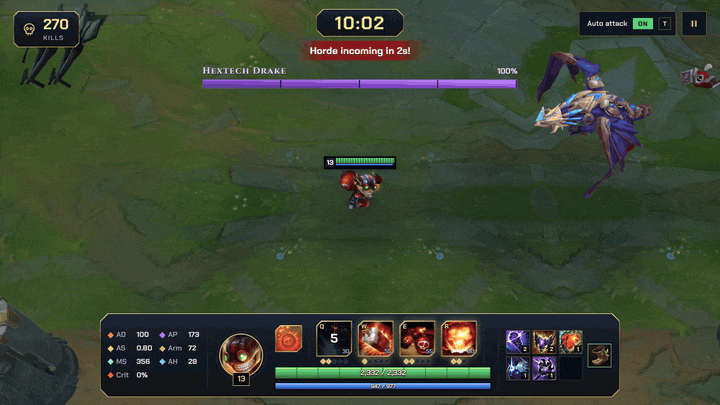
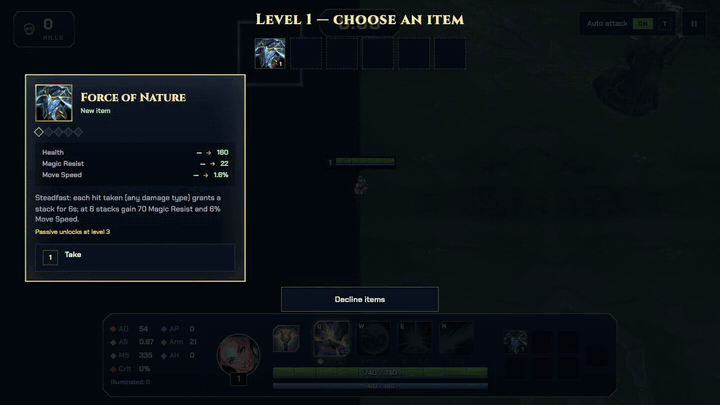
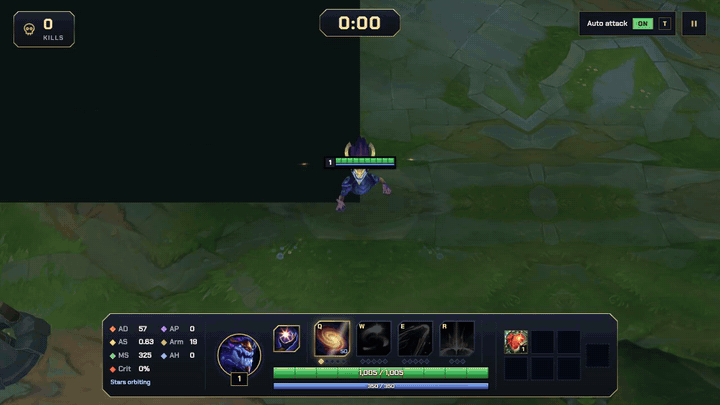
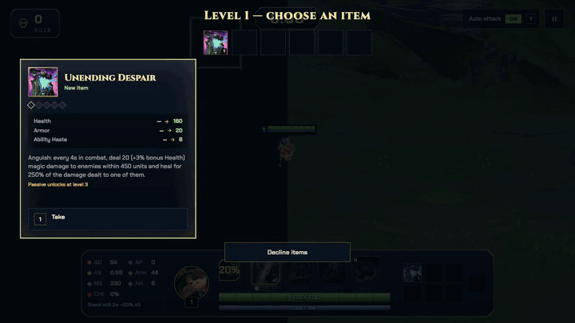
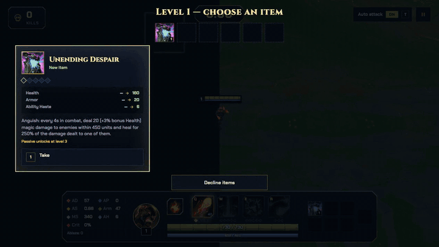
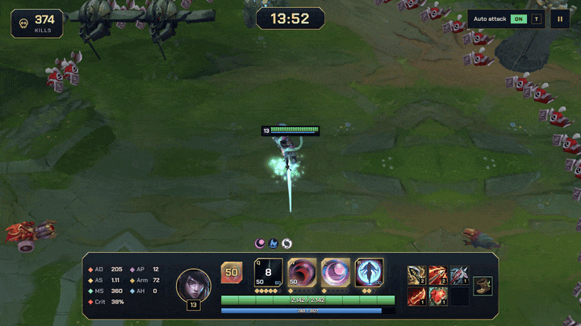
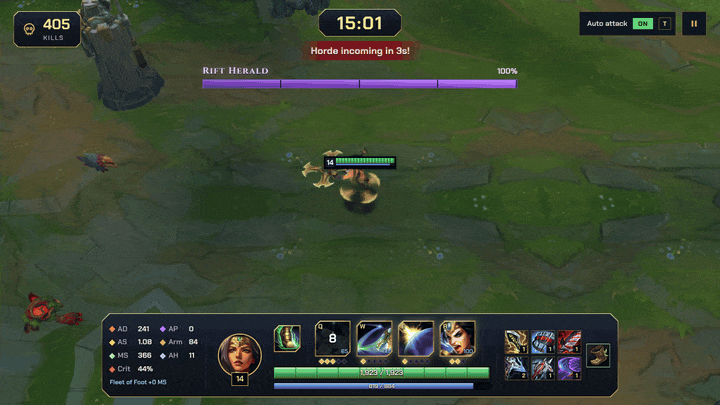
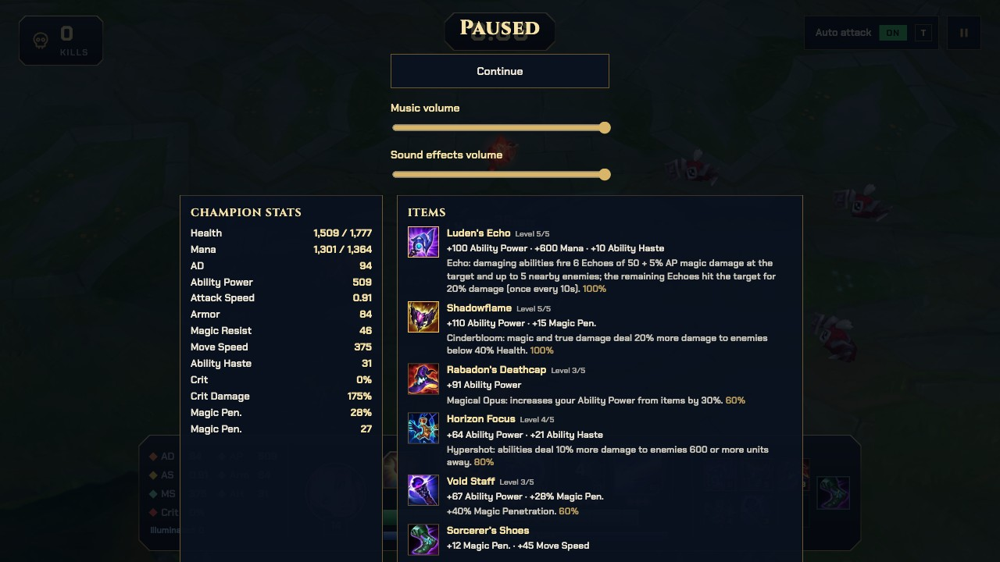

<p align="center">
  
</p>

<p align="center">
  <b>English</b> · <a href="README.pt-BR.md">Português</a> · <a href="README.zh-CN.md">简体中文</a>
</p>

<p align="center">
  <b>A 2.5D survivors-like for the browser, starring League of Legends champions.</b><br>
  Top-down view with the original LoL 3D models and animations. Survive the hordes, level up your items and take down Baron Nashor at 20 minutes.
</p>

<p align="center">
  
  
  
  
</p>

<p align="center">
  <a href="https://league-of-survivors.gabriel-m-lyra.workers.dev"><b>▶ Play the demo</b></a>
</p>

<p align="center">
  
</p>

> The game is in English, Portuguese, Spanish and Simplified Chinese, picked from the browser language.

## Champions

Ten playable champions, each with a full kit ported from LoL (details in [Implemented rules](#implemented-rules)):

| Champion | Roles | Style |
|---|---|---|
| Ezreal | Marksman · Mage | Skillshots; Q hits cut every cooldown, Arcane Shift blink |
| Samira | Marksman · Assassin | Melee/ranged mix that raises a Style grade up to S for her ultimate |
| Brand | Mage · Support | Ablaze burns that detonate and spread through the horde |
| Aphelios | Marksman | Five weapons with Moonlight ammo, each with its own attack and Q |
| Aurelion Sol | Mage | Stars orbiting him, a flight over walls, a falling meteor |
| Teemo | Marksman · Mage | Stand still for attack speed, poison on hit, bouncing mushroom traps |
| Lux | Mage · Support | Illumination marks, roots, a shield and the Final Spark laser |
| Ziggs | Mage | Lobbed bombs: a bouncing bomb, a satchel that blasts enemies (and Ziggs) away, a minefield and a map-wide nuke |
| Sivir | Marksman | Boomerang blade out and back, ricocheting attacks, a spell shield and On the Hunt |
| Twitch | Marksman · Assassin | Deadly Venom stacks, a venom cask pool, Contaminate and piercing Spray and Pray bolts |

## Gallery

| Champion select | Rune page |
|---|---|
|  |  |

| Level-up: abilities | Level-up: items |
|---|---|
|  |  |

| Ziggs |
|---|
|  |

| Lux | Aurelion Sol |
|---|---|
|  |  |

| Teemo | Brand |
|---|---|
|  |  |

| Aphelios | Samira |
|---|---|
|  |  |

| Sivir | |
|---|---|
|  | |

| Baron Nashor (20:00) | Pause menu: stats, items and boots |
|---|---|
|  |  |

| Victory | Phone (touch controls) |
|---|---|
|  |  |

<sub>Logo and banner source: `docs/media/logo.html` (open it in Chromium and capture `#logo` / `#banner`). Screenshots are from the prototype running with locally generated assets.</sub>

## Running

```bash
pnpm install
pnpm dev        # http://localhost:5173 (pick the champion on the first screen)
```

The models are **not in the repository** (they are Riot assets). Generate them locally first (below).

## Asset pipeline (macOS, with LoL installed)

1. Tools: Python 3 and the .NET 8 SDK (without admin rights: `curl -sSL https://dot.net/v1/dotnet-install.sh | bash -s -- --channel 8.0 --install-dir ~/.dotnet`, then call `~/.dotnet/dotnet`). `l2g/` is git-ignored: build it once and keep it.
   ```bash
   python3 -m venv .venv-tools && .venv-tools/bin/pip install xxhash zstandard pillow pygltflib
   git clone https://github.com/Crauzer/lol2gltf && cd lol2gltf/src/lol2gltf
   # the csproj is pinned to win-x64: set RuntimeIdentifier to osx-arm64, turn off PublishReadyToRun and RestorePackagesWithLockFile
   dotnet publish -c Release -o ../../../l2g
   ```
2. Hash list (the game's `.bin` files reference textures/animations by xxh64 hash):
   ```bash
   curl -s https://raw.communitydragon.org/data/hashes/lol/hashes.game.txt \
     | grep -E "assets/characters/(ezreal|samira|brand|aphelios|aurelionsol|lux|teemo|ziggs|sivir|twitch|sru_|turret|inhibitor|nexus)" > assets-raw/hashes.filtered.txt
   ```
3. Extract from the WADs (`tools/extract_lol.py`) and convert to `.glb` (`tools/build_models.py`):
   ```bash
   G="/Applications/League of Legends.app/Contents/LoL/Game/DATA/FINAL"
   .venv-tools/bin/python tools/extract_lol.py assets-raw/hashes.filtered.txt ezreal assets-raw/ezreal "$G/Champions/Ezreal.wad.client"
   .venv-tools/bin/python tools/extract_lol.py assets-raw/hashes.filtered.txt samira assets-raw/samira "$G/Champions/Samira.wad.client"
   .venv-tools/bin/python tools/extract_lol.py assets-raw/hashes.filtered.txt brand assets-raw/brand "$G/Champions/Brand.wad.client"
   .venv-tools/bin/python tools/extract_lol.py assets-raw/hashes.filtered.txt aurelionsol assets-raw/aurelionsol "$G/Champions/AurelionSol.wad.client"
   .venv-tools/bin/python tools/extract_lol.py assets-raw/hashes.filtered.txt teemo assets-raw/teemo "$G/Champions/Teemo.wad.client"
   .venv-tools/bin/python tools/extract_lol.py assets-raw/hashes.filtered.txt sivir assets-raw/sivir "$G/Champions/Sivir.wad.client"
   .venv-tools/bin/python tools/extract_lol.py assets-raw/hashes.filtered.txt twitch assets-raw/twitch "$G/Champions/Twitch.wad.client"
   .venv-tools/bin/python tools/extract_lol.py assets-raw/hashes.filtered.txt teemomushroom assets-raw/teemomushroom "$G/Champions/Teemo.wad.client"
   .venv-tools/bin/python tools/extract_lol.py assets-raw/hashes.filtered.txt lux assets-raw/lux "$G/Champions/Lux.wad.client"
   .venv-tools/bin/python tools/extract_lol.py assets-raw/hashes.filtered.txt ziggs assets-raw/ziggs "$G/Champions/Ziggs.wad.client"
   # Aphelios and Crescendum's sentry (a character of its own in the same WAD)
   for c in aphelios apheliosturret; do .venv-tools/bin/python tools/extract_lol.py assets-raw/hashes.filtered.txt $c assets-raw/$c "$G/Champions/Aphelios.wad.client"; done
   for c in sru_chaosminion{melee,ranged,siege,super} sru_orderminionmelee sru_krug sru_murkwolf sru_razorbeak sru_razorbeakmini sru_gromp sru_blue sru_red sru_riftherald sru_baron sru_crab sru_dragon sru_dragon_{air,fire,earth,water,hextech,chemtech}; do
     .venv-tools/bin/python tools/extract_lol.py assets-raw/hashes.filtered.txt $c assets-raw/$c "$G/Maps/Shipping/Map11.wad.client" "$G/Maps/Shipping/Common.wad.client"
   done
   # SR structures (map scenery): the character folder is turret/inhibitor/nexus
   for c in turret inhibitor nexus; do
     .venv-tools/bin/python tools/extract_lol.py assets-raw/hashes.filtered.txt $c assets-raw/$c "$G/Maps/Shipping/Map11.wad.client" "$G/Maps/Shipping/Common.wad.client"
   done
   .venv-tools/bin/python tools/build_models.py l2g/lol2gltf
   ```
   Output: `public/assets/models/<id>.glb` + `<id>.png`. The PNG is applied at runtime because `lol2gltf` only embeds `.tex/.dds`.
   The structures have a fixed line in `tools/build_models.py` (`sruap_orderturret|orderinhibitor|ordernexus`, `own_anm=False` because they are static scenery) and come out as `public/assets/models/sruap_*.glb|png`.
4. Map: terrain and rock textures, extracted from `Map11.wad.client`. First download the full CommunityDragon hash lists (`hashes.game.txt` and `hashes.bin{entries,fields,types,hashes}.txt` from `https://raw.communitydragon.org/data/hashes/lol/`) into `assets-raw/hashes/`: `textures` uses `hashes.game.txt` as its name table, and `pieces` needs the `.bin*` lists so `read_bin` can resolve the `.mapgeo` names.
   ```bash
   G="/Applications/League of Legends.app/Contents/LoL/Game/DATA/FINAL"
   .venv-tools/bin/python tools/build_map.py textures assets-raw/hashes/hashes.game.txt public/assets/map "$G/Maps/Shipping/Map11.wad.client"
   .venv-tools/bin/python tools/build_map.py pieces assets-raw/hashes/hashes.game.txt public/assets/map "$G/Maps/Shipping/Map11.wad.client"
   ```
   Output: `public/assets/map/tex/{ground_river,ground_lane,ground_jungle,ground_base,water}.png` (~400 px crops of the SR atlases) and `public/assets/map/pieces/rock_{a,b,c}.glb|png` (the three largest rock/cliff sections of `base.mapgeo`, normalized to 1 unit and scaled to cover the obstacle box).
   `pieces` is a limited `.mapgeo` v14 parser: if it is skipped or fails (different format version, missing WAD), the runtime draws dark boxes/cylinders from the layout obstacles. Nothing breaks.
5. Ability VFX: Ezreal's particle systems read from the skin `.bin`, with every texture and mesh they use. Uses the hash lists downloaded in step 4:
   ```bash
   for c in ezreal samira brand aphelios aurelionsol lux teemo ziggs sivir twitch; do (cd tools && ../.venv-tools/bin/python build_vfx.py ../assets-raw/hashes $c ../public/assets/vfx/$c "$G"); done
   ```
   Generates `systems.json` (effects indexed by `ResourceResolver` keys, e.g. `Ezreal_Q_mis`), `spells.json` (missile speed/width/range) and the asset PNG/JSON files. `tools/read_bin.py` alone converts any `.bin` into JSON. The emitter runtime lives in `src/particles.ts`; `src/vfx.ts` only picks which system to play and where.

6. Sounds and music: Wwise banks (`.bnk`/`.wpk`) for Ezreal, the monsters, the HUD and the Map11 music. Needs `brew install vgmstream ffmpeg` and [wwiser](https://github.com/bnnm/wwiser):
   ```bash
   git clone --depth 1 https://github.com/bnnm/wwiser assets-raw/wwiser
   (cd tools && ../.venv-tools/bin/python build_audio.py "$PWD/../assets-raw/wwiser/wwiser.py" ../public/assets/sfx "$G")
   ```
   wwiser generates one `.txtp` per event, vgmstream renders it and ffmpeg converts it to mp3. Events are found by id (FNV-1 of the name; the names come from the characters' `.bin` files, the table is `BANKS` in the script). Random containers become up to 4 variations (`<key>_<n>.mp3`), picked at runtime. Output: `public/assets/sfx/*.mp3` + `sounds.json`. Without the folder, the game runs muted.
   Events not found (silent): minion deaths and the Ocean/Hextech/Chemtech dragon attacks. The music is the main SR event with no known name (id `3832820115`); each switch state becomes one track.

## Procedural map

The world has no edge and no invisible walls: `src/sessions.ts` describes the layout of a 6000×6000 session (`CHUNK`) and `src/map.ts` keeps a 3×3 window of chunks around the player (`WorldMap.ensureChunks`). Each call generates at most 2 new chunks and drops everything that leaves the window; fog (`THREE.Fog`, 5000–9500) hides the loaded edge.

Each chunk rolls a type when generated, with repeats allowed and no persistence (leaving and coming back can give another type):

- `river`: a river with walkable water banks and brush boxes on both banks.
- `lane`: 4 turrets in the corners.
- `jungle`: 2–7 rock walls; ~40% of them get a decorative rock.
- `base`: nexus in the center, inhibitor and 2–3 turrets around it.

Obstacles are **pure physics**: turrets, inhibitors and the nexus neither attack nor can be attacked (right click still only focuses real units) and do not block projectiles — missiles, the E blink and water pass over them. Only bodies (player and enemies) collide, sliding along the obstacle (`resolveCircle`); there is no pathfinding: enemies walk straight at Ezreal and go around whatever they touch.

The assets come from step 4 of the pipeline: one texture per chunk type (the water also scrolls its offset) and pieces loaded by `loadMapPieces()`. A missing piece, or one that fails to load, falls back to the obstacle's dark box/cylinder. Nothing breaks.

## Controls

| Action | Key |
|---|---|
| Move | Right click on the ground (hold to follow the cursor) or arrow keys |
| Focus target (with auto attack) | Right click on an enemy |
| Toggle auto attack | `T` |
| Manual attack (auto off) | Left click on an enemy |
| Abilities | `Q` `W` `E` `R` toward the cursor |
| Pick an upgrade | Click or `1`–`9` |
| Pause / toggle music and effects | `Esc` |

WASD is not used because it clashes with Q/W/E.

## Implemented rules

- **Ezreal true to LoL** (Meraki Analytics data): per-level stats with LoL's growth formula, attack windup of 18.75%, projectile at 2000 u/s, 175% crit.
  - **Passive (Rising Spell Force)**: +10% attack speed per ability hit, up to 5 stacks, lasts 6 s.
  - **Q**: −1.5 s on all cooldowns on hit.
  - **W**: marks the target; detonating it with an ability refunds mana.
  - **E**: 475 blink + homing projectile, prioritizing the marked target.
  - **R**: 1 s cast, passes through enemies, 50% damage to non-epic units.
- **Samira** (Meraki Analytics data): 500 range, 175% crit.
  - **Passive (Daredevil Impulse)**: a hit of a different type than the previous one (shot, blade, Q, W, E, R) raises the Style grade by one (E→S, 6 s, +2–3.5% movement speed per grade). Attacks within 200 range use the blade: bonus magic damage (2–19 + 3.5–10.5% AD), up to doubled by the target's missing health; W, E and the Q slash also apply it.
  - **Q**: shot at the first enemy; with an enemy ahead within 340, a cone slash. Can crit (125%).
  - **W**: two area slashes (325), at the start and after 0.75 s; destroys enemy projectiles in the area. No basic attacks while spinning.
  - **E**: 600 dash toward the cursor, magic damage to everyone passed through, +20–40% attack speed for 5 s.
  - **R**: only at Style S with an enemy within 600. 10 volleys over 2 s against everyone around (25% vs. minions), can crit; −30% movement speed, consumes Style.
  - Not from LoL: Style counts any enemy; no Q explosives during E; no attack on immobilized targets (not implemented yet).
- **Brand** (Meraki Analytics data and the skin bins): the first AP champion; 550 range. Every particle system of his kit is used (body flames, Ablaze marks, detonation ring and blast, every cast/missile/impact).
  - **Passive (Blaze)**: abilities apply Ablaze (up to 3 stacks, 4 s): a burn of 2% max health + 8–48 (level) + 5% AP per stack. The 3rd stack primes a ring that explodes after 2 s (radius 475): 8–12% max health (+2% per 100 AP, capped at 270–525) + 30–150 + 20% AP, and ablazes everyone hit. A detonated enemy holds at most 1 stack for 4 s. A kill by an ability or of an ablazed enemy restores 20–40 mana (once per second from minions and small monsters, always from elites and epics).
  - **Q**: fireball at the first enemy hit; stuns an ablazed target for 1.5 s.
  - **W**: after 0.627 s, area damage (260) at the target point; +25% against ablazed enemies.
  - **E**: targeted blast that spreads its damage to enemies within 300 of the target (600 if it was ablazed).
  - **R**: fireball that bounces up to 4 times (600), an ablazed enemy first; slows ablazed enemies 30–60% for 0.25 s.
  - Not from LoL (mana balance for hordes): costs Q 40, W/E 45–65, R 80; the burn and the detonation have a flat part and the detonation works on any enemy; the burn ticks every 0.5 s; R never bounces back to Brand.
- **Aphelios** (client spell data from `aphelios.bin`, Meraki Analytics for base stats): 550 range. Five weapons with their own HUD: the main weapon's icon and Moonlight next to the abilities, Q = the main weapon's ability (named after the off-hand: e.g. Resurgent Moonshot), W = the off-hand and its Moonlight, E = the next weapon, the reserve queue above the slots.
  - **Passive (The Hitman and the Seer)**: starts with Calibrum (main) and Severum (off-hand), Gravitum, Infernum and Crescendum in reserve. 50 Moonlight per weapon: 1 per attack, 10 per Q (less than 10 left: the Q takes the rest). An empty main weapon goes to the end of the queue and the next one is assembled (no Phase for 1 s, its Q on at least 1.5 s cooldown). Skill points buy stats instead of ranks (Q +4 bonus AD, W +9% attack speed, E +4.5 lethality, rank 6 at level 9 at the earliest); Q unlocks at level 2, W and E at 1, R ranks up on its own at 6/11/16.
  - **Weapons**: Calibrum +100 range, ability hits mark for 4.5 s; the next attack on a mark (up to 1800 away) uses the off-hand weapon and pops every mark for 15 + 15% bonus AD each. Severum strikes at once and heals 2–7.1% of the damage (×2.5 from abilities); overheal becomes a shield (10–140 + 6% max health, 30 s). Gravitum slows 30% decaying to 10% (2.5 s). Infernum deals 110% AD and splits into 4 bolts behind the target (6 on crit, wider), 75%/100% (level 9) of the damage, 30% of that vs. minions. Crescendum is thrown, lingers 0.2 s and comes back at 600 (+750% bonus attack speed): each chakram circles Aphelios and is one more blade to throw: attacks throw the weapon, then the chakrams in orbit one after another with no attack timer (only the windup, like a machine gun; the HUD counts the ones in orbit), and only with every blade out he waits for a catch (then the attack timer resets, so the closer the target, the sooner). Abilities throw spectral chakrams; each one caught is a new chakram (up to 20, 5 s, refreshed by catches and Crescendum attacks): +15% AD for the first, down to +5% each.
  - **Q (by main weapon, 60 mana, numbers by level 1–13)**: Moonshot (70–160 + 42–60% bonus AD + 100% AP, 1450 range, marks); Onslaught (1.75 s, 6 attacks +2 per 100% bonus AS alternating off-hand and Severum, 20–41% AD each, on-hit at 25%, +25% movement speed); Binding Eclipse (only with a Gravitum target: 50–140 + 32–50% bonus AD + 70% AP magic damage and 1 s root on every slowed enemy); Duskwave (40° cone of 650: 20–110 + 15–21% bonus AD + 70% AP, then an off-hand attack on each enemy hit); Sentry (thrown within 475, arms after 0.35 s, lasts 20 s or 4 s once an enemy is within 500, attacks with the off-hand weapon at Aphelios' attack speed for 35–125 + 34–52% bonus AD + 50% AP).
  - **W (Phase)**: swaps main and off-hand; each weapon keeps its own Q cooldown.
  - **R (Moonlight Vigil)**: after 0.5 s a ball of moonlight (2050 speed, 1300, trailing a moonbeam from the weapon) stops on the first enemy and blasts 300 around for 125/175/225 + 20% bonus AD + 100% AP, then Aphelios attacks each target with the main weapon: Calibrum marks for 50/80/110, Severum heals 250/350/450, Gravitum slows 99% (Binding Eclipse roots it 1.35 s), Infernum +50/100/150 + 25% bonus AD and a ring of bolts, Crescendum +5 chakrams plus one per target.
  - Not from LoL: what targets champions targets any enemy (the R beam stops on the first enemy, Severum's R heal and Crescendum's chakram refresh); enemies do not attack the sentry (it lasts its timer).
- **Aurelion Sol** (today's model, VFX and sounds; the pre-rework kit from Data Dragon 13.1.1 and its stats; R is today's meteor): 550 range.
  - **Passive (Center of the Universe)**: 3 stars orbit him (250 units, one turn per 6 s) and hit every enemy they pass over for 20–120 (level) + W rank bonus + 25% AP magic damage (once per star per pass). Star kills restore 4–12 mana (0.5 s cooldown against minions and small monsters).
  - **Q (Starsurge)**: a star flies forward (600 speed) growing from 150 to 450 radius while Aurelion stays within 650; it detonates when he leaves, after 5 s or at full size: 70–230 + 65% AP (up to +50% by size) and a 0.55–1.1 s stun.
  - **W (Celestial Expansion)**: passive +5–25 damage per star hit. Toggle: stars fly out to 650, orbit three times as fast (one turn per 2 s) and deal 40% more, draining 6–10 mana per second (switches off when mana runs out).
  - **E (Comet of Legend)**: 3 s flight along the cast direction over walls and units with +60–100% Move Speed, no attacks; a move order (click or arrow keys) ends it.
  - **R (Falling Star)**: a meteor lands on the target area after 1 s: 200/325/450 + 75% AP within 450 and a 1 s knock-up.
  - Not from LoL: costs Q 50–70, R 100, W has no activation cost; E is steerable and on a 20–12 s cooldown (was a long locked line on 80–60 s); the star mana restore; Starsurge wears today's Singularity vortex (E), growing with its radius, and blasts with Falling Star's impact particles (today's kit has no growing star).
- **Teemo** (LoL stats; Guerrilla Warfare without invisibility): 500 range, ability power items.
  - **Passive (Guerrilla Warfare)**: standing still for 2 s camouflages Teemo (stealth idle pose, no invisibility): +20/40/60/80% attack speed (levels 1/5/10/15) while he stays still and for 5 s after he moves. The gauge fills while he stands still.
  - **Q (Blinding Dart)**: a dart at the target enemy (680 range) for 80–260 + 70% AP and a 4–6 s blind (its basic attacks miss).
  - **W (Move Quick)**: passive +12–28% Move Speed; active doubles it for 3 s.
  - **E (Toxic Shot)**: passive. Basic attacks deal 9–65 + 30% AP on-hit magic damage and poison for 6–30 + 10% AP per second over 4 s (145% against monsters).
  - **R (Noxious Trap)**: up to 3 charges, recharged one after the other (30/25/20 s, shortened by ability haste). Tosses a mushroom (600/750/900 range) that arms after 1 s and lasts 5 min; an enemy stepping on it (135) sets it off: 200/325/450 + 50% AP within 400 and a 30–50% slow for 4 s. A mushroom landing on another bounces 350/450/550 further, again while it keeps landing on mushrooms.
  - Not from LoL: no invisibility; Q costs 40–60 (was 70–90) and always blinds for the doubled minion/monster duration; W's passive is never lost (no enemy champions nor turrets); R keeps 3 charges at every rank (was 3/4/5) and deals its damage at once (was a 4 s poison).
- **Lux**: 550 range.
  - **Passive (Illumination)**: damaging abilities mark the enemies they hit for 6 s; Lux's next basic attack or Final Spark on a marked enemy consumes the mark for 30–200 (level) + 30% AP bonus magic damage. An illuminated enemy dying restores 10–30 mana (level; 1 s cooldown against minions and small monsters).
  - **Q (Light Binding)**: a sphere of light (1200 speed, 1175 range) deals 80–240 + 65% AP to the first two enemies hit and roots them for 2 s.
  - **W (Prismatic Barrier)**: the wand flies out to 1175 and back; Lux gains a 40–100 + 40% AP Shield for 2.5 s when she throws it and another when it returns (they stack).
  - **E (Lucent Singularity)**: a singularity flies to the target area (1100 range) and slows enemies within 310 by 25–45% (lingering 1 s); pressing E again detonates it (on arrival if still flying), otherwise it goes off after 5 s: 65–265 + 80% AP and the same slow for 1 s.
  - **R (Final Spark)**: after a 1 s channel, a laser 3340 long and 190 wide deals 300/400/500 + 120% AP to every enemy in the line; it detonates Illumination and marks again.
  - Not from LoL: costs Q 40, W 40–60, E 50–70, R 80; the mana on illuminated kills (shown with the skin's unused `Lux_globalhit_mana` flash); Prismatic Barrier only shields Lux.
- **Ziggs** (client spell data from `ziggs.bin` for every number, LoL Wiki for what the bin leaves to scripts): 550 range, ability power items. Every bomb is lobbed with the bins' gravity (arc peak = gravity × time² / 8), including his basic attacks.
  - **Passive (Short Fuse)**: every 12 s (static) the next basic attack throws a bigger bomb for 20–160 (level breakpoints 1/7/13) + 50% AP bonus magic damage; each ability cast takes 4/5/6 s (levels 1/7/13) off that cooldown at the start of the cast. The bomb in his hand glows while it is ready; the gauge counts down.
  - **Q (Bouncing Bomb)**: thrown toward the cursor (850 range, 1700 speed), it bounces forward twice (325 and 225 at max range, scaled by the throw, 0.48 s each) and explodes when it lands within 180 of an enemy or on its last bounce: 80–280 + 60–80% AP within 240 (1400 total reach).
  - **W (Satchel Charge)**: a charge (1000 range, 1750 speed) that sits for 4 s; pressing W again detonates it (on landing if still flying): 70–210 + 50% AP within 325, knocking enemies out to 500 from the center over 0.5 s. If Ziggs is in the blast, he jumps out to 775 from the center.
  - **E (Hexplosive Minefield)**: a cluster (900 range) scatters 11 mines (3 inner, 8 on a 200 ring, random turn) that arm after 0.5 s and last 10 s; each explodes on an enemy within 135: 30–190 + 25–45% AP and a 10–50% slow for 1.5 s; an enemy already hit by the cast takes 40% from later mines.
  - **R (Mega Inferno Bomb)**: 5000 range; lands after 1.2 s within 2700, else distance / 2250: 300/500/700 + 100% AP within the 250 epicenter, 65% of that out to 525. Landing-zone indicator from the cast, the closing ring 0.65 s before the blast.
  - Not from LoL: costs Q 30–40, W 55, E 50–75, R 80 (Brand's cuts); ability kills restore 10–30 mana (level; 1 s cooldown against minions and small monsters); the Minefield's inner ring radius (100) and the thresholds between R's long-range missiles are estimates (script-side, not in the bin); no turret execute (no turrets).
- **Sivir** (the DataValues of her spell bins, patch 26.20): 500 range, 1750 u/s blades thrown from alternating hands, 175% crit. Every gameplay particle system of the skin is used (both attack blades and impacts, the boomerang out and back, the Ricochet glow/blade/hit, the barrier, block and heal, the speed lines, the On the Hunt swirl and trail).
  - **Passive (Fleet of Foot)**: basic attacks (on attack) and ability hits grant 55–75 (level) flat Move Speed decaying over 1.5 s.
  - **Q (Boomerang Blade)**: the crossblade flies 1250 units (1450 speed, 180 wide) and returns to her (1200 speed, 200 wide), dealing 60–160 + 70% bonus AD + 60% AP physical damage to every enemy on each pass (once per pass), increased by 0–40% by critical strike chance (+12% with Infinity Edge); each enemy hit reduces the damage by 15%, down to 40%, reset on the way back. Cast time 0.25 s, cut by half the bonus attack speed up to 60%.
  - **W (Ricochet)**: for 4 s, +20–40% attack speed and the basic attacks bounce up to 8 times to the nearest new enemy within 500 (each enemy at most twice) for 40–50% AD (×2 on a crit, +30% with Infinity Edge; 65% against minions, executing them below 15 health). Resets the attack timer on a fresh buff. Runaan's bolts do not ricochet.
  - **E (Spell Shield)**: 1.5 s spell shield, no mana cost; blocking a hostile effect (enemy missile, hazard, Baron attack; melee hits are not spells) heals 60–80% AD + 50% AP and triggers Fleet of Foot after 0.25 s.
  - **R (On the Hunt)**: +20/25/30% Move Speed for 8/10/12 s; while active, every basic attack cuts Q, W and E's cooldowns by 0.5 s.
  - Not from LoL: Fleet of Foot counts every enemy (champions only in LoL); On the Hunt is refreshed by elite and epic takedowns (champion takedowns within 3 s in LoL) and has no ally aura; mana costs are LoL's (Q 55–75, W 60, E 0, R 100).
- **Twitch** (the DataValues of his spell bins, patch 26.21; LoL Wiki V26.16 for script rules): 550 range, 2500 u/s bolts, 20.2% windup. Every gameplay particle system of the skin is used (bolts and impacts, the rat-skull stack icons and poison smoke, the cask, burst, pool, ring and slow debuff, the toxin and its burst, the Ambush poof, hand glow and haste, the Spray and Pray aura, crossbow glow, bolts and hits, the idle smoke).
  - **Passive (Deadly Venom)**: on-hit (basic attacks, Runaan's bolts, every enemy a Spray and Pray bolt hits) and Venom Cask apply a stack for 6 s (refreshed, up to 6): 1/2/3/4/5 (levels 1/5/9/13/17) + 3% AP true damage per stack every second.
  - **Q (Ambush)**: 10% Move Speed for 10–14 s and 40–60% Attack Speed for 6 s; 16 s cooldown, 40 mana.
  - **W (Venom Cask)**: a cask lobbed up to 950 (1400 speed, gravity 4000) bursts within 300: a stack and a 30–50% (+6% per 100 AP) slow; the pool lasts 3 s, slowing enemies inside and adding a stack each second (at most 4 per enemy per cask).
  - **E (Contaminate)**: needs a poisoned enemy within 1200; a toxin flies to each (3000 speed) and deals 20–60 + 15–35 (+35% bonus AD) physical and 35% AP magic damage per stack held when the cast began.
  - **R (Spray and Pray)**: 6 s of +30/45/60 AD and +300 attack range; basic attacks become bolts (5000 speed, 120 wide) reaching attack range + 250 that hit every enemy in line with on-hit effects, 10% less per enemy hit, down to 60%. Runaan's bolts do not pierce.
  - Not from LoL: no invisibility, so Ambush grants both buffs at once (LoL: Move Speed while camouflaged, Attack Speed on leaving it); its cooldown resets on elite and epic kills (LoL: an enemy champion dying while poisoned); the stealth systems and the E range ring are left out.
- **Two-step level-up**:
  1. One ability rank, by LoL's rule: basic abilities at levels 1/3/5/7/9, R at levels 6/11/16 (Aphelios: stat points, see above). The step is skipped when no rank is available.
  2. One item out of 3 rolled (or a potion, once the build is complete).
- **Items**: real Data Dragon data (stats, names, icons), generated by `tools/build_items.py` into `src/items.json`; passives in `src/itemPassives/`.
  - No recipes: a level-up offers a finished legendary item or one more level for an item you own, like the weapons of a survivors game. Inventory of at most 6 items; items cannot be discarded.
  - Every item has 5 levels. Stats grow from 40% (level 1) to 100% (level 5); the passive unlocks at level 3 at 60% strength, 80% at level 4, 100% at level 5. Manamune, Archangel's Staff and Winter's Approach gain their transformed passive (Muramana, Seraph's Embrace, Fimbulwinter) at level 5.
  - Pool: every Summoner's Rift legendary except items with an active (Zhonya's, Youmuu's, the Hydras...), support items, anti-heal items (Mortal Reminder, Chempunk, Morellonomicon; Thornmail keeps only its reflect) and passives that need vision or champion shields (Umbral Glaive, Serpent's Fang). AD champions get attack items, AP champions ability power items, both get tanks and hybrids.
  - Passives adapted to hordes: "champion" triggers become elite/epic monster kills; spell shields block the next damage taken.
  - Recommended build per champion (OP.GG, patch 16.21): offered three times as often and tagged "Recommended". Ezreal: Trinity Force, Manamune, Spear of Shojin, Serylda's Grudge, Endless Hunger, Guardian Angel. Samira: The Collector, Infinity Edge, Lord Dominik's Regards, Immortal Shieldbow, Bloodthirster, Guardian Angel. Brand: Blackfire Torch, Rylai's, Liandry's, Shadowflame, Rabadon's, Void Staff. Aphelios: The Collector, Infinity Edge, Lord Dominik's Regards, Runaan's Hurricane, Guardian Angel, Bloodthirster. Aurelion Sol: Liandry's, Rylai's, Rabadon's, Void Staff, Shadowflame, Cosmic Drive. Teemo: Nashor's Tooth, Liandry's Torment, Riftmaker, Rabadon's Deathcap, Void Staff, Shadowflame. Lux: Luden's Echo, Shadowflame, Rabadon's, Horizon Focus, Void Staff, Malignance. Ziggs: Luden's Echo, Shadowflame, Rabadon's Deathcap, Void Staff, Banshee's Veil, Horizon Focus. Sivir: Essence Reaver, Navori Flickerblade, Infinity Edge, Lord Dominik's Regards, Bloodthirster, Guardian Angel. Twitch: Blade of the Ruined King, Guinsoo's Rageblade, Runaan's Hurricane, Infinity Edge, Lord Dominik's Regards, Guardian Angel.
  - Complete build (6 items at level 5): level-ups offer a Health or Mana Potion (5% of max), and each kill has a 1% chance to drop a blueprint (blue scroll, 1 per run) that makes a random item Legendary (+50% stats; its slot gets an animated gold ring and a "Legendary" ribbon).
  - Boots: a 7th slot outside the six. Boots (+25 Move Speed) at 5:00; killing the Rift Scuttler offers a pick of Berserker's Greaves, Boots of Swiftness, Sorcerer's Shoes, Plated Steelcaps (Plating: physical hits deal 10% less), Mercury's Treads or Ionian Boots of Lucidity; killing the dragon turns them into their tier 3 (Gunmetal Greaves, Swiftmarch, Spellslinger's Shoes, Armored Advance, Chainlaced Crushers, Crimson Lucidity: stats only).
  - Pace: the enemy side (movement, attacks, animations, boss attacks, enemy projectiles, spawn rate) speeds up from x1 at 0:00 to x1.5 at 5:00, then stays at x1.5. The clock, cooldowns, buffs and the champion keep real time.
  - Standing still: damage taken grows (after armor) up to x5 after 5 seconds without moving.
  - ESC menu: every champion stat and each item with its stats and passive.
  - Resistances: physical damage is reduced by the enemy's armor (armor penetration, lethality), magic damage by its magic resist (magic penetration; monsters have half their armor as MR, minions none). Ranged enemies' projectiles deal magic damage (reduced by your MR), melee hits physical damage.
- **Ranged enemies**: fire straight-line skillshots aimed where Ezreal was, with limited range. They can be dodged.
- **Difficulty curve**: early on, 1 basic attack or 1 ability kills.
  - Health: base × `(1 + 0.08 × (level − 1)) × (1 + time / 900 s)`.
  - Damage: base × `(1 + time / 600 s)`.
  - Epic monsters have fixed health.
  - Tune in `enemyHpScale` / `enemyDamageScale` (`src/data.ts`).
- **XP**: absorbed automatically on kill.
- **Floating text**: damage dealt (white = physical, blue = magic, orange = crit), damage taken (red) and XP gained (purple).
- **Spawn director**: enemies per second = `0.45 + 0.04×(level−1) + time/450`.
  - That value is multiplied by 0.6–1.3 depending on the fraction of the last 20 s of enemies the player killed.
  - The number of living enemies is capped: `12 + 2×level + time/8`.
  - Tune in `DIRECTOR` (`src/data.ts`).
- **Horde**: every 2 min, a ring of `15 + 2×level` weak enemies closes around the player, with a 90° gap to escape. The warning shows 6 s before.
- **Progression (survivors style)**:
  - 0–5 min: minions.
  - From 3 min: raptors, wolves, krugs, gromp.
  - Bosses: Rift Scuttler (5:00), Dragon (10:00, element rolled among Mountain, Cloud, Ocean, Hextech, Infernal and Chemtech; buffs not implemented yet), Rift Herald (15:00), Baron Nashor (20:00).
  - Elites between bosses: Blue Sentinel (7:30), Red Brambleback (12:30), both together (17:30).
  - Tune in `EVENTS` (`src/data.ts`).
- **Baron Nashor (20:00)**: 70k health. Killing him wins the run.
  - When he spawns, every other enemy dies and nothing else spawns (not even hordes).
  - A circular arena (radius 1500) closes around Ezreal and the Baron. You cannot walk out.
  - If Ezreal leaves (e.g. Arcane Shift over the wall), a tentacle pulls him back.
  - Abilities with cast time and a ground marker:
    - Ground circles: after 1 s, knock up and stun (up to ~500 damage, never kills).
    - A tentacle bursting from the ground where Ezreal was: kills.
    - Acid spit in a line: kills.
  - Near the Baron: 33% chance of a bite (swallows, instant, cannot be dodged). Otherwise, a cone whip: 75% of max health, never kills.
  - Tune in `BARON` (`src/data.ts`); behavior in `src/enemies/baron.ts`.

## Balance

Current tuning, in one place (the full rules are above):

| What | Value | Where |
|---|---|---|
| Game pace (enemies only) | x1 at 0:00 to x1.5 at 5:00, then x1.5 | `PACE` (`src/game.ts`) |
| Standing still | damage taken up to x5 after 5 s without moving | `CAMPING` (`src/game.ts`) |
| Baron Nashor | 70k health (fixed, no time scaling) | `ENEMIES.baron` (`src/data.ts`) |
| Potions (complete build) | 5% of max health or mana | `POTION` (`src/items.ts`) |
| Boots | at 5:00, tier 2 from the Rift Scuttler, tier 3 from the dragon | `BOOTS_AT`, `BOOT_UPGRADES` (`src/items.ts`) |
| Enemy health / damage | `× (1 + 0.08 × (level − 1)) × (1 + time / 900 s)` / `× (1 + time / 600 s)` | `enemyHpScale` / `enemyDamageScale` (`src/data.ts`) |
| Spawns | `0.45 + 0.04 × (level − 1) + time / 450` per second, ×0.6–1.3 by kill rate, cap `12 + 2 × level + time / 8` | `DIRECTOR` (`src/data.ts`) |

Mages cast nonstop against hordes, so their LoL mana costs are lowered and their mana on kills has an internal cooldown against minions (1 s; 0.5 s for Aurelion Sol's stars):

| Champion | Costs (LoL in brackets) | Mana on kills |
|---|---|---|
| Brand | Q 40, W/E 45–65, R 80 | 20–40 on kills by an ability or of an ablazed enemy |
| Aurelion Sol | Q 50–70, R 100, W no activation cost (drains 6–10/s) | 4–12 per star kill |
| Teemo | Q 40–60 (70–90) | none |
| Lux | Q 40, W 40–60, E 50–70, R 80 | 10–30 when an illuminated enemy dies |
| Ziggs | Q 30–40 (50–70), W 55 (80), E 50–75 (70–110), R 80 (100) | 10–30 on ability kills |
| Sivir | LoL's (Q 55–75, W 60, E 0, R 100): she lives off basic attacks | none |
| Twitch | LoL's (Q 40, W 70, E 50–90, R 100): he lives off basic attacks | none |

## Architecture (where to add content)

- **Champions** (`src/champion.ts`, `src/champions/`): a champion is a `ChampionDef` (base stats, skills with ranks/costs/cooldowns/animation/icon, animations, basic attack VFX) plus a `kit`, created each run, which resolves the skills and keeps their quirks (stacks, marks...). `Game` handles the generic parts: movement, basic attack, cooldowns, mana, items and the damage pipeline.
  - New champion: create `src/champions/<name>.ts` (templates: `ezreal.ts`; `brand.ts` for an AP mage with damage over time and per-enemy marks) and register it in `src/champions/index.ts`. Sounds follow `<id>_auto`, `<id>_Q`, `<id>_death`... Step-by-step guide: `.claude/skills/creating-champions/SKILL.md`.
  - Kit hooks: `cast` (required), `castStart`, `castAnim`, `canCast`, `recast` (the skill pressed while on cooldown, e.g. detonating Lucent Singularity), `attackSpeedBonus`/`moveSpeedBonus`, `disarmed`, `ghost` (no wall nor unit collision, e.g. Comet of Legend), `steer`/`onMoveOrder` (walks the champion on its own until a move order, e.g. Comet of Legend's course), `meleeAuto`, `onDamage` (extra magic damage before mitigation, e.g. detonating the W mark), `onKill` (e.g. Blaze's mana on kills), `onDealt` (damage after mitigation, e.g. Severum's heal), `update`, `dispose`, `hud`, `gauge`. Champions with more than one form (Aphelios' weapons): `stat` (own stats, e.g. points bought), `attackTarget`/`attackStart`/`basicAttack` (target, clip, sound and windup of the basic attack, firing it), `moveAnims`, `cooldownBase`/`castTime` (per form), `skillView` (slot icon, name and badge) and `tray` (small icons above the slots).
  - `ChampionDef` extras: `idleVfx` (systems riding bones all run long, e.g. Brand's flames), `vfx.death`, `scale` (model size), `sequences` (clips joined end to end, the bin's SequencerClipData, e.g. Aurelion Sol's run), `translucent` (submeshes blended by texture alpha instead of cut out, e.g. his tail), `conformPath` (joint chain bent along the travelled path, the bin's ConformToPathRigPoseModifierData), `itemPool: 'ap'` for mages (skills scale with `apRatio`), `build` (the 6 recommended legendaries from a build site, offered more often and tagged on level up), `rankLevels` (level of each rank), `autoRank` (skills ranked without a point) and `SkillDef.unlockLevel` (castable from a level, whatever its ranks).
  - Crowd control on enemies: `game.slow(e, pct, s)`, `game.stunEnemy(e, s)` and `game.rootEnemy(e, s)` (no moving, still attacks) (generic loop only; boss AIs ignore them). `game.knockUp(e, s)` is a stun that throws the model into the air (Falling Star). `game.knockBack(e, offset, s)` also carries it along the ground (Satchel Charge); `game.dash(dir, dist, speed, height)` can jump.
  - Projectiles: `game.spawnMissile(vfx, from, to, { hit, target | pierce, onHit, ... })`. Without `onHit`, the default impact applies VFX, sound and damage.
- **Item passives** (`src/itemEffects.ts` hooks, entries in `src/itemPassives/ad.ts`, `ap.ts`, `tank.ts`): each entry has the description (max-level numbers) and a hook factory `effect(g, power)` (`onHit`, `onHitMagic`, `onAttack`, `onCast`, `onDealt`, `onKill`, `onHurt`, `onStruck`, `onOverheal`, `tick`, `onLethal`, `stat`, `damageMult`...). `power()` is the passive's strength at the item's level (0.6/0.8/1): effects multiply their numbers by it, all-or-nothing ones (revive, spell shield) stretch their cooldown. Shared mechanics in `src/itemPassives/shared.ts`: Spellblade, Lifeline, spell shield, burns, Energized. `unique` + `rank` reproduce LoL's UNIQUE passives (only the best one works). Stats stay in `items.json`.
- **Enemies** (`src/data.ts` + `src/enemies/`): a regular enemy only needs an `EnemyDef`. Custom behavior registers an AI in `AI`; timeline events with special rules (rolled dragon, Baron arena) register a spawner in `SPAWNERS`. `src/hazards.ts` has the ground markers and eruptions for bosses.
- **Performance**: enemies live in a spatial grid (`src/spatial.ts`), so unit collision, targeting, projectiles and auras only query neighbors (collision used to be O(n²)). Per-frame lists are filtered in place (`compact`), spawn/kill windows are amortized O(1), the map rebuilds nothing while the player stays in the same chunk, and the HUD only writes to the DOM when a value changes. Enemies far from the champion update their animation every 3 frames, and enemies outside the camera view are neither drawn nor animated (their animation time catches up when they come back). Particle emitters share one material per definition, so a burst never recompiles a shader, and reuse pooled geometry that uploads only the vertices written; overlapping copies of a one-shot effect (impacts on a crowd) thin out: the first 8 emit everything, the n-th 8/n of it, and past 6000 live particles every new one-shot thins too (`src/vfx.ts`).

## Known limitations / next steps

- Particles: child particle sets (`childParticleSetDefinition`) ride their parent particle, at the joints of a skinned particle mesh (`.skn` drawn static in bind pose, `.skl` joints exported by `build_vfx.py`). `VfxPrimitiveBeam` (from the particle to the system's `target`, or to its own target offset; meshes stretched along Z; ground-layer beams lie on the terrain), `VfxPrimitiveRay`, `VfxPrimitiveAttachedMesh` (the owner's skinned mesh redrawn as a glow or frozen-pose afterimage), force fields (acceleration, drag, attraction) and `FlexShapeDefinition` (scaled to the target's size) are supported. Not implemented: orbital/noise fields, distortion; attached meshes ignore birth scale, UV scroll and erosion; mesh particles with `uvMode` 2 and scrolling multiply textures (Lux's constellation rings) render faint; ground-layer quads sit at a fixed height, so the raised spawn platform clips them. Beam UVs: U across (textures are cross-section profiles), V along, repeating every `mBirthTilingSize.y`; `scale.x` is the full width. `colorLookUpTypeY` 3 picks a random row of the colour texture per particle; particle rotations use the YXZ order. Cast effects ride the bone named by the skin's animation events (`Actor.bone`, `Vfx.playOn`); with `ChampionDef.animVfx` the game plays those events itself (`events.json` from `build_vfx.py`: the particle events of each clip; a clip file shared by variants that play different effects is left to the kit). `blendMode` missing/4 = additive, 1 = alpha (inferred from the textures, not documented).
- The source `.glb` files are heavy (Ezreal 29 MB, Baron 45 MB); `pnpm build:prod` (`tools/optimize.mjs`) drops clips the code never names, resamples and meshopt-compresses them (Ezreal 1.9 MB, Baron 1.9 MB).
- Each enemy is a SkinnedMesh with its own mixer, capped at 260 alive (`MAX_ENEMIES`). For bigger hordes: texture-baked animation + instancing.
- Dragons: animations shared from `sru_dragon`. Infernal and Mountain use the Cloud mesh (`sru_dragon_air`) with their own texture, as in the game (`EnemyDef.mesh`).
- Next champions (chosen for wave clear): Sivir, Ziggs, Orianna, Viktor, Tristana, Jinx, Garen, Gangplank, Darius, Irelia, Olaf, Xerath, Karthus, Cassiopeia, Malzahar.

## Legal notice

Non-commercial fan project, under Riot Games' "Legal Jibber Jabber" policy. League of Legends and all its assets belong to Riot Games, Inc. Do not distribute the extracted models.
