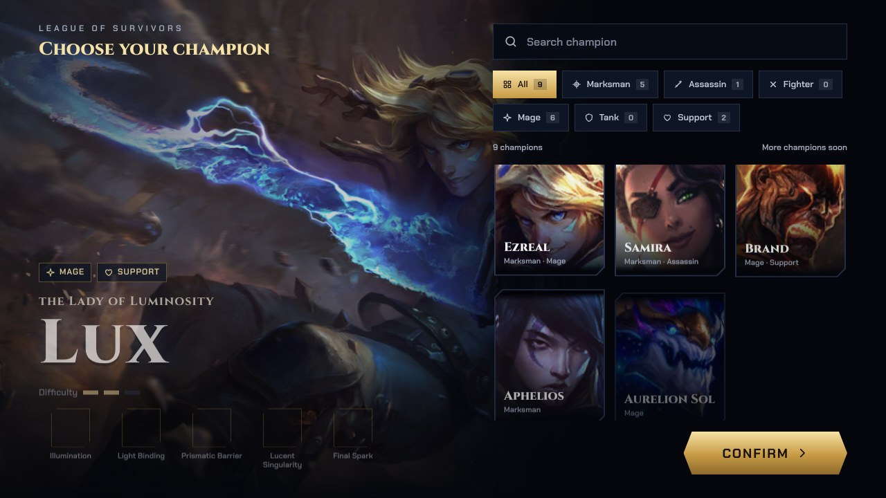
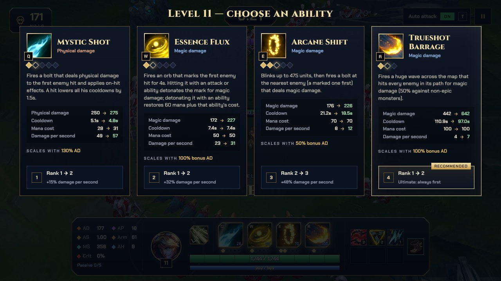
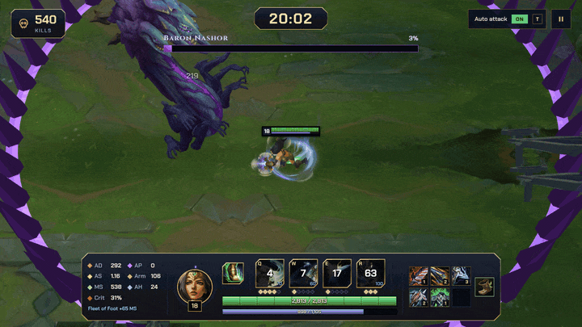
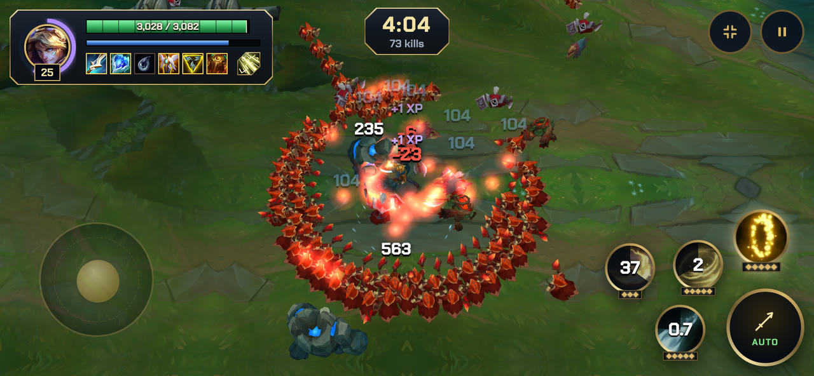

<p align="center">
  
</p>

<p align="center">
  <a href="README.md">English</a> · <b>Português</b> · <a href="README.zh-CN.md">简体中文</a>
</p>

<p align="center">
  <b>Survivors-like 2.5D no navegador com campeões de League of Legends.</b><br>
  Vista superior, modelos 3D e animações originais do LoL. Sobreviva às hordas, suba o nível dos itens e derrube o Barão Na'Shor aos 20 minutos.
</p>

<p align="center">
  
  
  
  
</p>

<p align="center">
  <a href="https://league-of-survivors.gabriel-m-lyra.workers.dev"><b>▶ Jogue a demo</b></a>
</p>

<p align="center">
  
</p>

> O jogo está em inglês, português, espanhol e chinês simplificado, escolhido pelo idioma do navegador.

## Galeria

| Seleção de campeão | Página de runas |
|---|---|
|  |  |

| Level-up: habilidades | Level-up: itens |
|---|---|
|  |  |

| Samira | Barão Na'Shor (20:00) |
|---|---|
|  |  |
|  |  |

| Vitória | Celular (controles de toque) |
|---|---|
|  |  |

<sub>Logo e banner: fonte em `docs/media/logo.html` (abra no Chromium e capture `#logo` / `#banner`). As capturas são do protótipo rodando com os assets gerados localmente.</sub>

## Rodar

```bash
pnpm install
pnpm dev        # http://localhost:5173 (escolha o campeão na primeira tela)
```

Os modelos **não estão no repositório** (são assets da Riot). Gere-os localmente primeiro (abaixo).

## Pipeline de assets (macOS, com LoL instalado)

1. Ferramentas: Python 3 e .NET 8 SDK (sem admin: `curl -sSL https://dot.net/v1/dotnet-install.sh | bash -s -- --channel 8.0 --install-dir ~/.dotnet`, depois use `~/.dotnet/dotnet`). `l2g/` é ignorado pelo git: compile uma vez e mantenha.
   ```bash
   python3 -m venv .venv-tools && .venv-tools/bin/pip install xxhash zstandard pillow pygltflib
   git clone https://github.com/Crauzer/lol2gltf && cd lol2gltf/src/lol2gltf
   # o csproj vem fixo em win-x64: troque RuntimeIdentifier para osx-arm64, desligue PublishReadyToRun e RestorePackagesWithLockFile
   dotnet publish -c Release -o ../../../l2g
   ```
2. Lista de hashes (os `.bin` do jogo referenciam texturas/animações por hash xxh64):
   ```bash
   curl -s https://raw.communitydragon.org/data/hashes/lol/hashes.game.txt \
     | grep -E "assets/characters/(ezreal|samira|brand|aphelios|aurelionsol|teemo|sru_|turret|inhibitor|nexus)" > assets-raw/hashes.filtered.txt
   ```
3. Extrair dos WADs (`tools/extract_lol.py`) e converter para `.glb` (`tools/build_models.py`):
   ```bash
   G="/Applications/League of Legends.app/Contents/LoL/Game/DATA/FINAL"
   .venv-tools/bin/python tools/extract_lol.py assets-raw/hashes.filtered.txt ezreal assets-raw/ezreal "$G/Champions/Ezreal.wad.client"
   .venv-tools/bin/python tools/extract_lol.py assets-raw/hashes.filtered.txt samira assets-raw/samira "$G/Champions/Samira.wad.client"
   .venv-tools/bin/python tools/extract_lol.py assets-raw/hashes.filtered.txt brand assets-raw/brand "$G/Champions/Brand.wad.client"
   .venv-tools/bin/python tools/extract_lol.py assets-raw/hashes.filtered.txt aurelionsol assets-raw/aurelionsol "$G/Champions/AurelionSol.wad.client"
   .venv-tools/bin/python tools/extract_lol.py assets-raw/hashes.filtered.txt teemo assets-raw/teemo "$G/Champions/Teemo.wad.client"
   .venv-tools/bin/python tools/extract_lol.py assets-raw/hashes.filtered.txt teemomushroom assets-raw/teemomushroom "$G/Champions/Teemo.wad.client"
   # Aphelios e a atalaia do Crescendum (um personagem próprio no mesmo WAD)
   for c in aphelios apheliosturret; do .venv-tools/bin/python tools/extract_lol.py assets-raw/hashes.filtered.txt $c assets-raw/$c "$G/Champions/Aphelios.wad.client"; done
   for c in sru_chaosminion{melee,ranged,siege,super} sru_orderminionmelee sru_krug sru_murkwolf sru_razorbeak sru_razorbeakmini sru_gromp sru_blue sru_red sru_riftherald sru_baron sru_crab sru_dragon sru_dragon_{air,fire,earth,water,hextech,chemtech}; do
     .venv-tools/bin/python tools/extract_lol.py assets-raw/hashes.filtered.txt $c assets-raw/$c "$G/Maps/Shipping/Map11.wad.client" "$G/Maps/Shipping/Common.wad.client"
   done
   # estruturas do SR (scenery do mapa): a pasta do personagem é turret/inhibitor/nexus
   for c in turret inhibitor nexus; do
     .venv-tools/bin/python tools/extract_lol.py assets-raw/hashes.filtered.txt $c assets-raw/$c "$G/Maps/Shipping/Map11.wad.client" "$G/Maps/Shipping/Common.wad.client"
   done
   .venv-tools/bin/python tools/build_models.py l2g/lol2gltf
   ```
   Saída: `public/assets/models/<id>.glb` + `<id>.png`. O PNG é aplicado em runtime porque o `lol2gltf` só embute `.tex/.dds`.
   As estruturas já têm linha fixa em `tools/build_models.py` (`sruap_orderturret|orderinhibitor|ordernexus`, `own_anm=False` porque são cenário estático) e saem como `public/assets/models/sruap_*.glb|png`.
4. Mapa: texturas do terreno e rochas, extraídas do `Map11.wad.client`. Baixe antes as listas de hashes completas do CommunityDragon (`hashes.game.txt` e `hashes.bin{entries,fields,types,hashes}.txt` de `https://raw.communitydragon.org/data/hashes/lol/`) em `assets-raw/hashes/`: o `textures` usa o `hashes.game.txt` como tabela de nomes e o `pieces` precisa das listas `.bin*` para o `read_bin` resolver os nomes do `.mapgeo`.
   ```bash
   G="/Applications/League of Legends.app/Contents/LoL/Game/DATA/FINAL"
   .venv-tools/bin/python tools/build_map.py textures assets-raw/hashes/hashes.game.txt public/assets/map "$G/Maps/Shipping/Map11.wad.client"
   .venv-tools/bin/python tools/build_map.py pieces assets-raw/hashes/hashes.game.txt public/assets/map "$G/Maps/Shipping/Map11.wad.client"
   ```
   Saída: `public/assets/map/tex/{ground_river,ground_lane,ground_jungle,ground_base,water}.png` (recortes de ~400 px dos atlas do SR) e `public/assets/map/pieces/rock_{a,b,c}.glb|png` (as três maiores seções de rocha/penhasco do `base.mapgeo`, normalizadas para 1 unidade e escaladas para cobrir a caixa do obstáculo).
   O `pieces` é um parser limitado do `.mapgeo` v14: se for pulado ou falhar (versão diferente do formato, WAD ausente), o runtime desenha caixas/cilindros escuros a partir dos obstáculos do layout — nada quebra.
5. VFX das habilidades: sistemas de partículas do Ezreal lidos do `.bin` da skin, com todas as texturas e malhas que eles usam. Usa as listas de hashes baixadas no passo 4:
   ```bash
   for c in ezreal samira brand aphelios aurelionsol teemo; do (cd tools && ../.venv-tools/bin/python build_vfx.py ../assets-raw/hashes $c ../public/assets/vfx/$c "$G"); done
   ```
   Gera `systems.json` (efeitos indexados pelas chaves do `ResourceResolver`, ex. `Ezreal_Q_mis`), `spells.json` (velocidade/largura/alcance dos mísseis) e os PNG/JSON dos assets. `tools/read_bin.py` sozinho converte qualquer `.bin` em JSON. O runtime dos emissores fica em `src/particles.ts`; `src/vfx.ts` só escolhe qual sistema tocar e onde.

6. Sons e música: bancos Wwise (`.bnk`/`.wpk`) do Ezreal, dos monstros, do HUD e a música do Map11. Precisa de `brew install vgmstream ffmpeg` e do [wwiser](https://github.com/bnnm/wwiser):
   ```bash
   git clone --depth 1 https://github.com/bnnm/wwiser assets-raw/wwiser
   (cd tools && ../.venv-tools/bin/python build_audio.py "$PWD/../assets-raw/wwiser/wwiser.py" ../public/assets/sfx "$G")
   ```
   O wwiser gera um `.txtp` por evento, o vgmstream renderiza e o ffmpeg converte para mp3. Os eventos são achados pelo id (FNV-1 do nome; os nomes vêm dos `.bin` dos personagens, a tabela fica em `BANKS` no script). Containers aleatórios viram até 4 variações (`<chave>_<n>.mp3`), sorteadas em runtime. Saída: `public/assets/sfx/*.mp3` + `sounds.json`. Sem a pasta, o jogo roda mudo.
   Eventos não encontrados (ficam mudos): morte dos minions e ataque dos dragões Oceano/Hextech/Quimtech. A música é o evento principal do SR sem nome conhecido (id `3832820115`), cada estado do switch vira uma faixa.

## Mapa procedural

O mundo não tem borda nem paredes invisíveis: `src/sessions.ts` descreve o layout de uma sessão de 6000×6000 (`CHUNK`) e `src/map.ts` mantém uma janela 3×3 de chunks em volta do jogador (`WorldMap.ensureChunks`). Cada chamada gera no máximo 2 chunks novos e descarta tudo o que sai da janela; o fog (`THREE.Fog`, 5000–9500) esconde a borda carregada.

Cada chunk sorteia um tipo no momento da geração, com repetição permitida e sem persistência (sair e voltar pode render outro tipo):

- `river`: rio com margens de água andável e caixas de mata nas duas margens.
- `lane`: 4 torres nos cantos.
- `jungle`: 2–7 paredes de rocha; ~40% delas ganham uma rocha decorativa.
- `base`: nexus no centro, inibidor e 2–3 torres em volta.

Os obstáculos são **física pura**: torres, inibidores e o nexus não atacam nem são atacáveis (o clique direito continua focando só unidades reais) e não bloqueiam projéteis — mísseis, o blink do E e a água passam por cima. Só corpos (jogador e inimigos) colidem, deslizando ao longo do obstáculo (`resolveCircle`); não há pathfinding: o inimigo anda reto até o Ezreal e contorna o que encostar.

Os assets vêm do passo 4 do pipeline: textura por tipo de chunk (a água também rola o offset) e peças carregadas por `loadMapPieces()`. Peça ausente ou que falhe ao carregar cai na caixa/cilindro escuro do obstáculo — nada quebra.

## Controles

| Ação | Tecla |
|---|---|
| Mover | Botão direito no chão (segure para seguir o cursor) ou setas |
| Focar alvo (com ataque automático) | Botão direito no inimigo |
| Ligar/desligar ataque automático | `T` |
| Ataque manual (auto desligado) | Botão esquerdo no inimigo |
| Habilidades | `Q` `W` `E` `R` na direção do cursor |
| Escolher melhoria | Clique ou `1`–`9` |
| Pausar / ligar e desligar música e efeitos | `Esc` |

WASD não é usado porque colide com Q/W/E.

## Regras implementadas

- **Ezreal fiel ao LoL** (dados da Meraki Analytics): stats por nível com a fórmula de crescimento do LoL, ataque com windup de 18,75%, projétil a 2000 u/s, crítico de 175%.
  - **Passiva (Rising Spell Force)**: +10% de velocidade de ataque por acerto de habilidade, até 5 acúmulos, dura 6 s.
  - **Q**: −1,5 s em todas as recargas ao acertar.
  - **W**: marca o alvo; a detonação devolve mana quando feita por habilidade.
  - **E**: blink de 475 + projétil teleguiado, priorizando o alvo marcado.
  - **R**: 1 s de conjuração, atravessa inimigos, 50% de dano em não-épicos.
- **Samira** (dados da Meraki Analytics): alcance 500, crítico de 175%.
  - **Passiva (Daredevil Impulse)**: acerto de tipo diferente do anterior (tiro, lâmina, Q, W, E, R) sobe um grau de Estilo (E→S, 6 s, +2–3,5% de velocidade de movimento por grau). Ataques a até 200 de distância usam a lâmina: dano mágico extra (2–19 + 3,5–10,5% AD), até dobrado pela vida perdida do alvo; W, E e o corte do Q também aplicam.
  - **Q**: tiro no primeiro inimigo; com inimigo à frente a até 340, corte em cone. Pode critar (125%).
  - **W**: dois cortes em área (325), no início e após 0,75 s; destrói projéteis inimigos na área. Sem ataque básico durante o giro.
  - **E**: dash de 600 na direção do cursor, dano mágico em quem atravessa, +20–40% de velocidade de ataque por 5 s.
  - **R**: só com Estilo S e inimigo a até 600. 10 rajadas em 2 s contra todos em volta (25% em tropas), pode critar; −30% de velocidade de movimento, consome o Estilo.
  - Fora do LoL: Estilo conta qualquer inimigo; sem explosivos do Q durante o E; sem o ataque em alvo imobilizado (ainda não implementado).
- **Brand** (dados da Meraki Analytics e dos bins da skin): primeiro campeão AP; alcance 550. Usa todos os sistemas de partícula do kit (chamas do corpo, marcas de Em Chamas, anel e explosão da detonação, todo cast/míssil/impacto).
  - **Passiva (Labareda)**: habilidades aplicam Em Chamas (até 3 acúmulos, 4 s): queimadura de 2% da vida máxima + 8–48 (nível) + 5% PdH por acúmulo. O 3º acúmulo arma um anel que explode após 2 s (raio 475): 8–12% da vida máxima (+2% a cada 100 PdH, limite 270–525) + 30–150 + 20% PdH, e põe em chamas todos os atingidos. Um inimigo detonado segura no máximo 1 acúmulo por 4 s. Um abate por habilidade ou de inimigo em chamas restaura 20–40 de mana (uma vez por segundo vindo de tropas e monstros pequenos; sempre de elites e épicos).
  - **Q**: bola de fogo no primeiro inimigo atingido; atordoa um alvo em chamas por 1,5 s.
  - **W**: após 0,627 s, dano em área (260) no ponto alvo; +25% contra inimigos em chamas.
  - **E**: explosão no alvo que espalha o dano para inimigos a até 300 dele (600 se ele estava em chamas).
  - **R**: bola de fogo que ricocheteia até 4 vezes (600), priorizando inimigos em chamas; aplica 30–60% de Lentidão por 0,25 s em inimigos em chamas.
  - Fora do LoL (balanço de mana para hordas): custos Q 40, W/E 45–65, R 80; queimadura e detonação têm parte fixa e a detonação vale para qualquer inimigo; a queimadura acerta a cada 0,5 s; o R nunca volta para o Brand.
- **Aphelios** (dados de spell do cliente em `aphelios.bin`, Meraki Analytics para os stats base): alcance 550. Cinco armas com HUD própria: ícone e munição da arma principal ao lado das habilidades, Q = habilidade da arma principal (com o nome dado pela secundária: ex. Disparo Lunar Ressurgente), W = a arma secundária e sua munição, E = a próxima arma, a fila de reserva acima dos slots.
  - **Passiva (O Assassino e a Profetisa)**: começa com Calibrum (principal) e Severum (secundária), Gravitum, Infernum e Crescendum na reserva. 50 de munição por arma: 1 por ataque, 10 por Q (com menos de 10, o Q gasta o resto). A arma principal vazia vai para o fim da fila e a próxima é montada (sem Fase por 1 s, Q dela com no mínimo 1,5 s de recarga). Pontos de habilidade compram atributos em vez de ranks (Q +4 de Dano de Ataque bônus, W +9% de Velocidade de Ataque, E +4,5 de Letalidade, rank 6 no nível 9 no mínimo); o Q libera no nível 2, W e E no 1, o R sobe sozinho em 6/11/16.
  - **Armas**: Calibrum +100 de alcance, acertos de habilidade marcam por 4,5 s; o próximo ataque numa marca (até 1800 de distância) usa a arma secundária e estoura todas as marcas, 15 + 15% do DdA bônus cada. Severum acerta na hora e cura 2–7,1% do dano (×2,5 vindo de habilidades); cura além da vida máxima vira Escudo (10–140 + 6% da vida máxima, 30 s). Gravitum causa 30% de Lentidão que cai para 10% (2,5 s). Infernum causa 110% do DdA e se divide em 4 projéteis atrás do alvo (6 no crítico, mais abertos), 75%/100% (nível 9) do dano, 30% disso contra tropas. Crescendum é arremessado, fica 0,2 s no alvo e volta a 600 (+750% da VA bônus): cada chakram orbita o Aphelios e é mais uma lâmina para arremessar: os ataques arremessam a arma e depois os chakrams da órbita um atrás do outro sem tempo de ataque (só a preparação, como uma metralhadora; o HUD conta os que estão na órbita), e só com todas as lâminas fora ele espera uma voltar (aí o tempo de ataque reinicia, então quanto mais perto o alvo, mais cedo). Habilidades arremessam chakrams espectrais; cada um pego vira um chakram novo (até 20, 5 s, renovados por pegadas e ataques do Crescendum): +15% do DdA pelo primeiro, caindo até +5% cada.
  - **Q (pela arma principal, 60 de mana, números pelos níveis 1–13)**: Disparo Lunar (70–160 + 42–60% do DdA bônus + 100% do PdH, alcance 1450, marca); Chacina (1,75 s, 6 ataques +2 por 100% de VA bônus alternando secundária e Severum, 20–41% do DdA cada, efeitos ao atacar a 25%, +25% de Velocidade de Movimento); Eclipse Restritivo (só com alvo do Gravitum: 50–140 + 32–50% do DdA bônus + 70% do PdH de dano mágico e 1 s de enraizamento em todo inimigo com Lentidão); Onda Sombria (cone de 40° e 650: 20–110 + 15–21% do DdA bônus + 70% do PdH, depois um ataque da secundária em cada inimigo atingido); Atalaia (arremessada até 475, arma em 0,35 s, dura 20 s ou 4 s quando um inimigo chega a 500, ataca com a arma secundária na Velocidade de Ataque do Aphelios por 35–125 + 34–52% do DdA bônus + 50% do PdH).
  - **W (Fase)**: troca principal e secundária; cada arma guarda a própria recarga do Q.
  - **R (Vigília do Plenilúnio)**: após 0,5 s uma bola de luar (velocidade 2050, 1300, com um feixe de luar saindo da arma) para no primeiro inimigo e explode 300 em volta por 125/175/225 + 20% do DdA bônus + 100% do PdH; depois Aphelios ataca cada alvo com a arma principal: Calibrum marca por 50/80/110, Severum cura 250/350/450, Gravitum causa 99% de Lentidão (o Eclipse Restritivo enraíza por 1,35 s), Infernum +50/100/150 + 25% do DdA bônus e um anel de projéteis, Crescendum +5 chakrams mais um por alvo.
  - Fora do LoL: o que mira campeões mira qualquer inimigo (o feixe do R para no primeiro inimigo, a cura do R do Severum e a renovação dos chakrams); inimigos não atacam a atalaia (ela dura o tempo dela).
- **Aurelion Sol** (modelo, VFX e sons atuais; o kit de antes do rework, do Data Dragon 13.1.1, e seus stats; o R é o meteoro atual): alcance 550.
  - **Passiva (Centro do Universo)**: 3 estrelas orbitam ao redor dele (250 unidades, uma volta a cada 3 s) e atingem todo inimigo por onde passam com 20–120 (nível) + bônus do rank do W + 25% PdH de dano mágico (uma vez por estrela a cada passagem). Abates das estrelas restauram 4–12 de mana (recarga de 0,5 s contra tropas e monstros pequenos).
  - **Q (Oscilação Estelar)**: uma estrela voa para frente (velocidade 600) crescendo de 150 a 450 de raio enquanto Aurelion fica a até 650; explode quando ele se afasta, após 5 s ou no tamanho máximo: 70–230 + 65% PdH (até +50% pelo tamanho) e Atordoamento de 0,55–1,1 s.
  - **W (Expansão Celestial)**: passiva +5–25 de dano por acerto de estrela. Ativa: as estrelas vão até 650, giram duas vezes mais rápido e causam 40% a mais, gastando 6–10 de mana por segundo (desliga quando a mana acaba).
  - **E (Cometa Lendário)**: voo de 3 s por cima de paredes e unidades com +60–100% de Velocidade de Movimento, sem atacar.
  - **R (Estrela Cadente)**: um meteoro cai na área alvo após 1 s: 200/325/450 + 75% PdH em 450 e arremesso ao ar de 1 s.
  - Fora do LoL: custos Q 50–70, R 100, W sem custo de ativação; o E é dirigível e tem recarga de 20–12 s (era uma linha longa e travada com 80–60 s); a mana das estrelas; a Oscilação Estelar usa o vórtice da Singularidade atual (E), crescendo com o raio, e explode com as partículas do impacto da Estrela Cadente (o kit atual não tem estrela que cresce).
- **Teemo** (stats do LoL; Técnicas de Guerrilha sem invisibilidade): alcance 500, itens de poder de habilidade.
  - **Passiva (Técnicas de Guerrilha)**: ficar parado por 2 s camufla o Teemo (pose de furtividade, sem invisibilidade): +20/40/60/80% de Velocidade de Ataque (níveis 1/5/10/15) enquanto ele fica parado e por 5 s depois que ele se move. O medidor enche enquanto ele está parado.
  - **Q (Dardo Ofuscante)**: um dardo no inimigo alvo (alcance 680) que causa 80–260 + 70% PdH e cega por 4–6 s (os ataques básicos dele erram).
  - **W (Mover Depressa)**: passivo +12–28% de Velocidade de Movimento; o ativo dobra esse bônus por 3 s.
  - **E (Tiro Tóxico)**: passivo. Ataques básicos causam 9–65 + 30% PdH de dano mágico ao atingir e envenenam por 6–30 + 10% PdH por segundo durante 4 s (145% contra monstros).
  - **R (Armadilha Venenosa)**: até 3 cargas, recarregadas uma após a outra (30/25/20 s, reduzidas pela Aceleração de Habilidade). Arremessa um cogumelo (alcance 600/750/900) que se arma após 1 s e dura 5 min; um inimigo que pisa nele (135) o detona: 200/325/450 + 50% PdH em 400 e Lentidão de 30–50% por 4 s. Um cogumelo que cai sobre outro quica 350/450/550 para frente, de novo enquanto continuar caindo sobre cogumelos.
  - Fora do LoL: sem invisibilidade; o Q custa 40–60 (era 70–90) e sempre cega pela duração dobrada contra tropas/monstros; o passivo do W nunca se perde (sem campeões nem torres inimigas); o R tem 3 cargas em todos os ranks (era 3/4/5) e causa o dano de uma vez (era um veneno de 4 s).
- **Level-up em duas etapas**:
  1. Um rank de habilidade, pela regra do LoL: básicas nos níveis 1/3/5/7/9, R nos níveis 6/11/16 (Aphelios: pontos de atributo, ver acima). A etapa é pulada quando não há rank disponível.
  2. Um item entre 3 sorteados (ou uma poção, com a build completa).
- **Itens**: dados reais do Data Dragon (atributos, nomes, ícones), gerados por `tools/build_items.py` em `src/items.json`; passivas em `src/itemPassives/`.
  - Sem receitas: o level-up oferece um item lendário pronto ou mais um nível para um item seu, como as armas de um survivors. Inventário de no máximo 6 itens; não é possível descartar.
  - Cada item tem 5 níveis. Os atributos crescem de 40% (nível 1) a 100% (nível 5); a passiva é liberada no nível 3 com 60% da força, 80% no nível 4 e 100% no nível 5. Manamune, Cajado do Arcanjo e Aproximação do Inverno ganham a passiva transformada (Muramana, Abraço do Serafim, Fimbulwinter) no nível 5.
  - Catálogo: todos os lendários do Summoner's Rift, menos itens com ativa (Zhonya, Youmuu, as Hidras...), itens de suporte, itens de corta-cura (Lembrete Mortal, Serrespada Quimtec, Morellonomicon; a Armadura de Espinhos fica só com o reflexo) e passivas que dependem de visão ou de escudos de campeão (Glaive Umbral, Presa da Serpente). Campeões AD recebem itens de ataque, campeões AP itens de poder de habilidade, e os dois recebem tanques e híbridos.
  - Passivas adaptadas às hordas: gatilhos de "campeão" viram abates de monstro elite/épico; escudos de feitiço bloqueiam o próximo dano sofrido.
  - Build recomendada por campeão (OP.GG, patch 16.21): ofertada três vezes mais e marcada como "Recomendado". Ezreal: Força da Trindade, Manamune, Lança de Shojin, Rancor de Serylda, Fome Eterna, Anjo Guardião. Samira: O Coletor, Gume do Infinito, Lembranças do Lorde Dominik, Arco-escudo Imortal, Sanguinária, Anjo Guardião. Brand: Tocha de Fogo Negro, Rylai, Liandry, Chama Sombria, Rabadon, Cajado do Vazio. Aphelios: A Coletora, Gume do Infinito, Lembranças do Lorde Dominik, Furacão de Runaan, Anjo Guardião, Sedenta por Sangue. Aurelion Sol: Liandry, Rylai, Rabadon, Cajado do Vazio, Chama Sombria, Ímpeto Cósmico. Teemo: Dente de Na'Shor, Tormento de Liandry, Criafendas, Capuz da Morte de Rabadon, Cajado do Vazio, Chama Sombria.
  - Build completa (6 itens no nível 5): o level-up oferece Poção de Vida ou de Mana (5% do máximo), e cada abate tem 1% de chance de derrubar um blueprint (pergaminho azul, 1 por run) que torna um item aleatório Lendário (+50% dos atributos; o slot ganha um anel dourado animado e a faixa "Lendário").
  - Botas: um 7º slot fora dos seis. Botas (+25 de Velocidade de Movimento) aos 5:00; abater o Aronguejo oferece Grevas do Berserker, Botas da Rapidez, Sapatos do Feiticeiro, Botas Galvanizadas de Aço (Blindagem: golpes físicos causam 10% menos dano), Passos de Mercúrio ou Botas Ionianas da Lucidez; abater o dragão as transforma no nível 3 (só atributos).
  - Ritmo: o jogo inteiro acelera de x1 aos 0:00 até x2 aos 5:00 e fica em x2.
  - Parado: o dano recebido cresce (após a armadura) até x5 depois de 5 segundos sem se mover.
  - Menu ESC: todos os atributos do campeão e cada item com seus atributos e passiva.
  - Resistências: dano físico é reduzido pela armadura do inimigo (penetração de armadura, letalidade), dano mágico pela resistência mágica (penetração mágica; monstros têm metade da armadura em RM, tropas nenhuma). Projéteis de inimigos à distância causam dano mágico (reduzido pela sua RM), golpes corpo a corpo dano físico.
- **Inimigos à distância**: disparam skillshots em linha reta, mirados onde o Ezreal estava, com alcance limitado. Dá para desviar.
- **Curva de dificuldade**: no início, 1 ataque básico ou 1 habilidade mata.
  - Vida: base × `(1 + 0,08 × (nível − 1)) × (1 + tempo / 900 s)`.
  - Dano: base × `(1 + tempo / 600 s)`.
  - Monstros épicos têm vida fixa.
  - Ajuste em `enemyHpScale` / `enemyDamageScale` (`src/data.ts`).
- **XP**: absorvida automaticamente ao matar.
- **Textos flutuantes**: dano causado (branco = físico, azul = mágico, laranja = crítico), dano recebido (vermelho) e XP ganha (roxo).
- **Diretor de spawn**: inimigos por segundo = `0,45 + 0,04×(nível−1) + tempo/450`.
  - Esse valor é multiplicado por 0,6–1,3 conforme a fração dos inimigos dos últimos 20 s que o jogador matou.
  - O número de inimigos vivos tem teto: `12 + 2×nível + tempo/8`.
  - Ajuste em `DIRECTOR` (`src/data.ts`).
- **Horda**: a cada 2 min, um anel de `15 + 2×nível` inimigos fracos se fecha ao redor do jogador, com uma abertura de 90° para fugir. O aviso aparece 6 s antes.
- **Progressão (estilo survivors)**:
  - 0–5 min: minions.
  - A partir de 3 min: raptors, lobos, krugs, gromp.
  - Chefes: Aronguejo (5:00), Dragão (10:00, elemento sorteado entre Montanha, Nuvens, Oceano, Hextech, Infernal e Quimtech; buffs ainda não implementados), Arauto do Vale (15:00), Barão Na'Shor (20:00).
  - Elites entre os chefes: Sentinela Azul (7:30), Brutamontes Vermelho (12:30), os dois juntos (17:30).
  - Ajustes em `EVENTS` (`src/data.ts`).
- **Barão Na'Shor (20:00)**: quase impossível de matar (150 mil de vida). Matá-lo vence a run.
  - Ao nascer, todos os outros inimigos morrem e nada mais nasce (nem hordas).
  - Uma arena circular (raio 1500) se fecha em volta do Ezreal e do Barão. Andando não dá para sair.
  - Se o Ezreal sair (ex.: Arcane Shift por cima da parede), um tentáculo o puxa de volta.
  - Habilidades com tempo de conjuração e marcador no chão:
    - Círculos no chão: depois de 1 s, arremessam para cima e atordoam (até ~500 de dano, não mata).
    - Tentáculo saindo do chão onde o Ezreal estava: mata.
    - Cuspe ácido em linha: mata.
  - Perto do Barão: 33% de chance de mordida (engole, instantânea, impossível de esquivar). Senão, chicotada em cone: 75% da vida máxima, nunca mata.
  - Ajustes em `BARON` (`src/data.ts`); comportamento em `src/enemies/baron.ts`.

## Arquitetura (onde adicionar conteúdo)

- **Campeões** (`src/champion.ts`, `src/champions/`): um campeão é um `ChampionDef` (stats base, skills com ranks/custos/recargas/animação/ícone, animações, VFX do ataque básico) mais um `kit`, criado a cada run, que resolve as skills e guarda as peculiaridades (acúmulos, marcas...). O `Game` cuida do genérico: movimento, ataque básico, recargas, mana, itens e o pipeline de dano.
  - Novo campeão: criar `src/champions/<nome>.ts` (modelos: `ezreal.ts`; `brand.ts` para mago AP com dano contínuo e marcas por inimigo) e registrar em `src/champions/index.ts`. Sons seguem `<id>_auto`, `<id>_Q`, `<id>_death`... Passo a passo: `.claude/skills/creating-champions/SKILL.md`.
  - Hooks do kit: `cast` (obrigatório), `castStart`, `castAnim`, `canCast`, `attackSpeedBonus`/`moveSpeedBonus`, `disarmed`, `ghost` (sem colisão com paredes nem unidades, ex. Cometa Lendário), `meleeAuto`, `onDamage` (dano mágico extra antes da mitigação, ex. detonar a marca do W), `onKill` (ex. mana da Labareda em abates), `onDealt` (dano após a mitigação, ex. a cura do Severum), `update`, `dispose`, `hud`, `gauge`. Campeões com mais de uma forma (as armas do Aphelios): `stat` (atributos próprios, ex. pontos comprados), `attackTarget`/`attackStart`/`basicAttack` (alvo, clip, som e windup do ataque básico, e o disparo), `moveAnims`, `cooldownBase`/`castTime` (por forma), `skillView` (ícone, nome e selo do slot) e `tray` (ícones pequenos acima dos slots).
  - Extras do `ChampionDef`: `idleVfx` (sistemas presos a ossos a run toda, ex. as chamas do Brand), `vfx.death`, `scale` (tamanho do modelo), `itemPool: 'ap'` para magos (skills escalam com `apRatio`), `build` (os 6 lendários recomendados de um site de builds, ofertados com mais frequência e marcados no level-up), `rankLevels` (nível de cada rank), `autoRank` (skills que sobem sem ponto) e `SkillDef.unlockLevel` (conjurável a partir de um nível, qualquer que seja o rank).
  - Controle em inimigos: `game.slow(e, pct, s)`, `game.stunEnemy(e, s)` e `game.rootEnemy(e, s)` (não anda, ainda ataca) (só no loop genérico; as IAs de chefe ignoram os dois últimos). `game.knockUp(e, s)` é um Atordoamento que joga o modelo para o alto (Estrela Cadente).
  - Projéteis: `game.spawnMissile(vfx, de, para, { hit, target | pierce, onHit, ... })`. Sem `onHit`, o impacto padrão aplica VFX, som e dano.
- **Passivas de itens** (hooks em `src/itemEffects.ts`, entradas em `src/itemPassives/ad.ts`, `ap.ts`, `tank.ts`): cada entrada tem a descrição (números do nível máximo) e uma fábrica de hooks `effect(g, power)` (`onHit`, `onHitMagic`, `onAttack`, `onCast`, `onDealt`, `onKill`, `onHurt`, `onStruck`, `onOverheal`, `tick`, `onLethal`, `stat`, `damageMult`...). `power()` é a força da passiva no nível do item (0,6/0,8/1): efeitos multiplicam seus números por ela, os de tudo-ou-nada (reviver, escudo de feitiço) esticam a recarga. Mecânicas comuns em `src/itemPassives/shared.ts`: Lâmina Arcana, Linha da Vida, escudo de feitiço, queimaduras, Energizado. `unique` + `rank` reproduzem as passivas ÚNICAS do LoL (só a melhor funciona). Stats continuam em `items.json`.
- **Inimigos** (`src/data.ts` + `src/enemies/`): inimigo comum só precisa do `EnemyDef`. Comportamento próprio registra uma IA em `AI`; eventos da linha do tempo com regra especial (dragão sorteado, arena do Barão) registram um spawner em `SPAWNERS`. `src/hazards.ts` tem os marcadores de chão e erupções para chefes.
- **Desempenho**: inimigos ficam numa grade espacial (`src/spatial.ts`), então colisão entre unidades, alvos, projéteis e auras consultam só os vizinhos (antes, colisão era O(n²)). Listas por frame são filtradas no lugar (`compact`), janelas de spawn/kill são O(1) amortizado, o mapa não refaz nada enquanto o jogador está no mesmo chunk, e o HUD só escreve no DOM quando um valor muda. Inimigos longe do campeão atualizam a animação a cada 3 frames.

## Limitações conhecidas / próximos passos

- Partículas: conjuntos de partículas filhas (`childParticleSetDefinition`) acompanham a partícula mãe, nos ossos da malha skinned da partícula (`.skn` desenhado estático na pose de bind, ossos do `.skl` exportados pelo `build_vfx.py`). `VfxPrimitiveBeam` (da partícula até o `target` do sistema, ou até o próprio offset de alvo; malhas esticadas no eixo Z; beams de chão ficam no terreno), `VfxPrimitiveRay`, `VfxPrimitiveAttachedMesh` (a malha do dono redesenhada como brilho ou pós-imagem com pose congelada), campos de força (aceleração, arrasto, atração) e `FlexShapeDefinition` (escala pelo tamanho do alvo) são suportados. Não implementados: campos orbitais/ruído, distorção; malhas anexadas ignoram escala de nascimento, rolagem de UV e erosão. Efeitos de cast seguem o osso indicado pelos eventos de animação da skin (`Actor.bone`, `Vfx.playOn`); com `ChampionDef.animVfx` o jogo toca esses eventos sozinho (`events.json` do `build_vfx.py`: os eventos de partícula de cada clip; arquivo de clip compartilhado por variantes com efeitos diferentes fica com o kit). `blendMode` ausente/4 = aditivo, 1 = alpha (inferido das texturas, não documentado).
- Os `.glb` de origem são pesados (Ezreal 29 MB, Barão 45 MB); `pnpm build:prod` (`tools/optimize.mjs`) remove os clips que o código não usa, faz resample e comprime com meshopt (Ezreal 1,9 MB, Barão 1,9 MB).
- Cada inimigo é um SkinnedMesh com o próprio mixer, com limite de 260 vivos (`MAX_ENEMIES`). Para hordas maiores: animação baked em textura + instancing.
- Dragões: animações compartilhadas do `sru_dragon`. Infernal e Montanha usam a malha do Nuvens (`sru_dragon_air`) com a própria textura, como no jogo (`EnemyDef.mesh`).

## Aviso legal

Projeto de fã, não comercial, conforme a política "Legal Jibber Jabber" da Riot Games. League of Legends e todos os assets pertencem à Riot Games, Inc. Não distribua os modelos extraídos.
