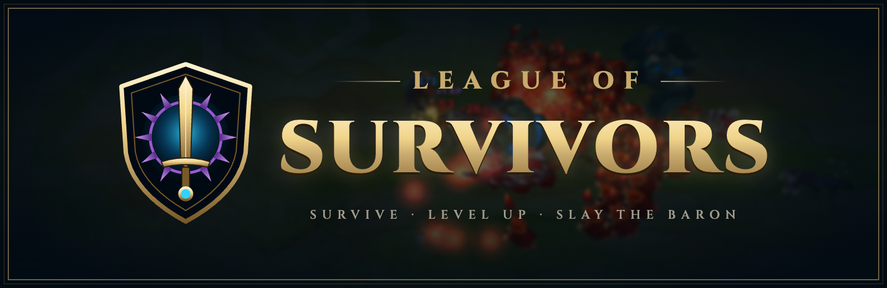
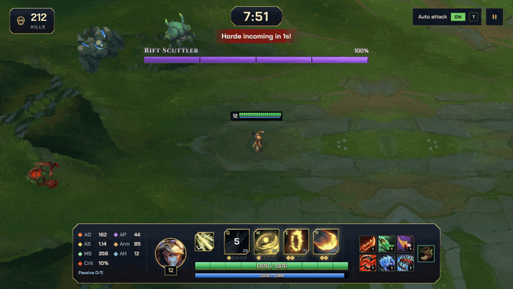
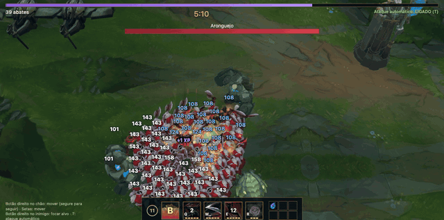
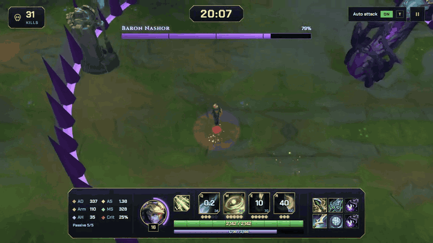
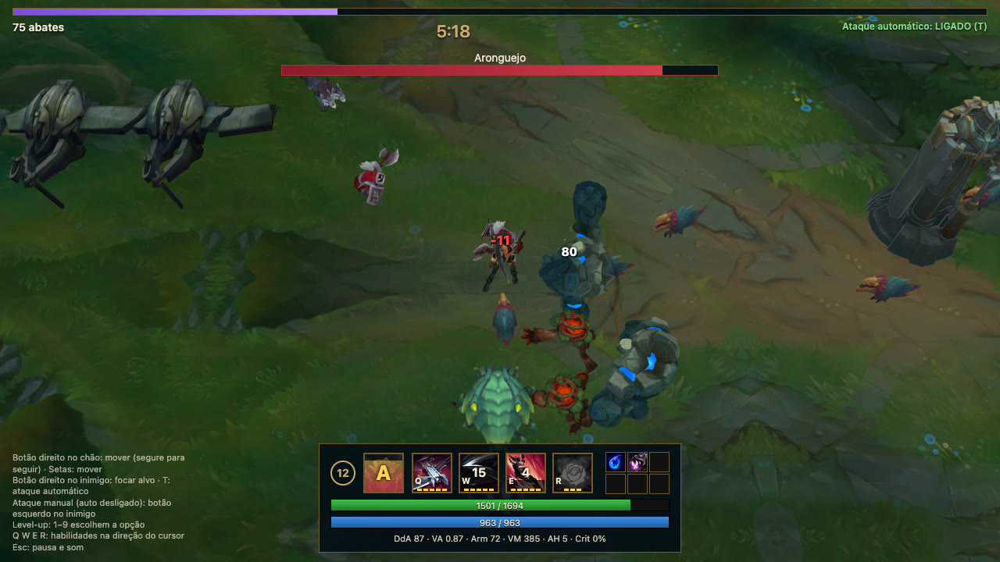
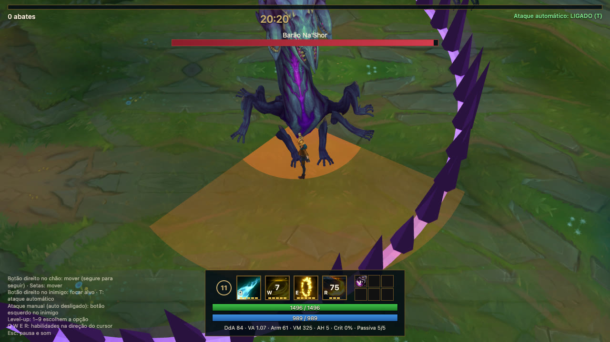
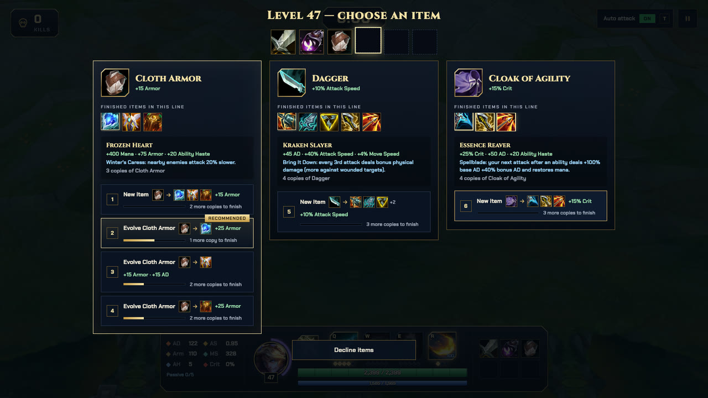
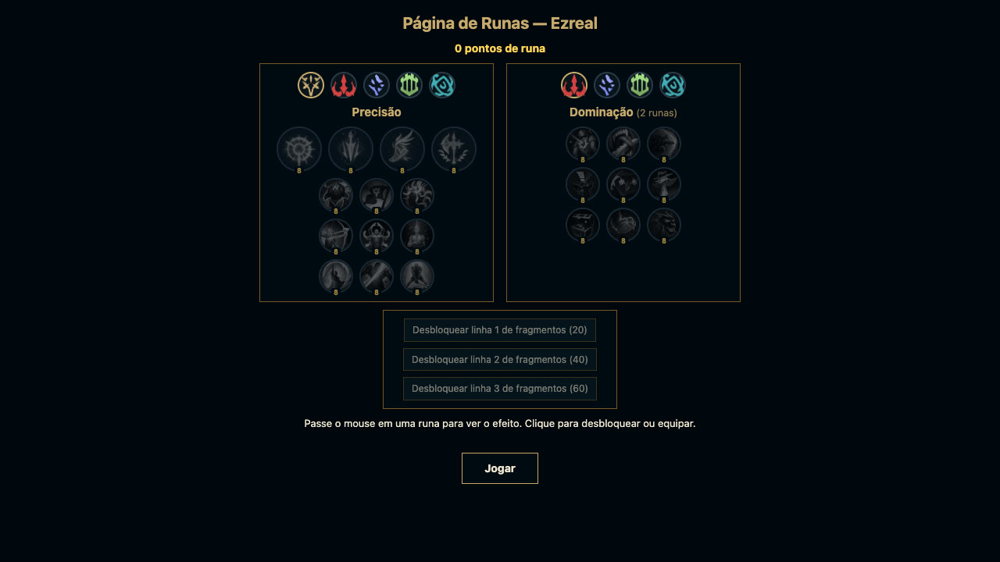

<p align="center">
  
</p>

<p align="center">
  <a href="README.md">English</a> · <b>Português</b> · <a href="README.zh-CN.md">简体中文</a>
</p>

<p align="center">
  <b>Survivors-like 2.5D no navegador com campeões de League of Legends.</b><br>
  Vista superior, modelos 3D e animações originais do LoL. Sobreviva às hordas, evolua itens e derrube o Barão Na'Shor aos 20 minutos.
</p>

<p align="center">
  
  
  
  
</p>

<p align="center">
  
</p>

## Galeria

| Samira (`?champ=samira`) | Barão Na'Shor (20:00) |
|---|---|
|  |  |
|  |  |

| Level-up: evolução de itens | Página de runas |
|---|---|
|  |  |

<sub>Logo e banner: fonte em `docs/media/logo.html` (abra no Chromium e capture `#logo` / `#banner`). As capturas são do protótipo rodando com os assets gerados localmente.</sub>

## Rodar

```bash
pnpm install
pnpm dev        # http://localhost:5173 (Ezreal); /?champ=samira joga com a Samira
```

Os modelos **não estão no repositório** (são assets da Riot). Gere-os localmente primeiro (abaixo).

## Pipeline de assets (macOS, com LoL instalado)

1. Ferramentas: Python 3 e .NET 8 SDK.
   ```bash
   python3 -m venv .venv-tools && .venv-tools/bin/pip install xxhash zstandard pillow pygltflib
   git clone https://github.com/Crauzer/lol2gltf && cd lol2gltf/src/lol2gltf
   # o csproj vem fixo em win-x64: troque RuntimeIdentifier para osx-arm64, desligue PublishReadyToRun e RestorePackagesWithLockFile
   dotnet publish -c Release -o ../../../l2g
   ```
2. Lista de hashes (os `.bin` do jogo referenciam texturas/animações por hash xxh64):
   ```bash
   curl -s https://raw.communitydragon.org/data/hashes/lol/hashes.game.txt \
     | grep -E "assets/characters/(ezreal|samira|sru_|turret|inhibitor|nexus)" > assets-raw/hashes.filtered.txt
   ```
3. Extrair dos WADs (`tools/extract_lol.py`) e converter para `.glb` (`tools/build_models.py`):
   ```bash
   G="/Applications/League of Legends.app/Contents/LoL/Game/DATA/FINAL"
   .venv-tools/bin/python tools/extract_lol.py assets-raw/hashes.filtered.txt ezreal assets-raw/ezreal "$G/Champions/Ezreal.wad.client"
   .venv-tools/bin/python tools/extract_lol.py assets-raw/hashes.filtered.txt samira assets-raw/samira "$G/Champions/Samira.wad.client"
   for c in sru_chaosminion{melee,ranged,siege,super} sru_orderminionmelee sru_krug sru_murkwolf sru_razorbeak sru_razorbeakmini sru_gromp sru_blue sru_red sru_riftherald sru_baron sru_crab sru_dragon sru_dragon_{air,fire,earth,water,hextech,chemtech}; do
     .venv-tools/bin/python tools/extract_lol.py assets-raw/hashes.filtered.txt $c assets-raw/$c "$G/Maps/Shipping/Map11.wad.client" "$G/Maps/Shipping/Common.wad.client"
   done
   # estruturas do SR (scenery do mapa): a pasta do personagem é turret/inhibitor/nexus
   for c in turret inhibitor nexus; do
     .venv-tools/bin/python tools/extract_lol.py assets-raw/hashes.filtered.txt $c assets-raw/$c "$G/Maps/Shipping/Map11.wad.client" "$G/Maps/Shipping/Common.wad.client"
   done
   .venv-tools/bin/python tools/build_models.py l2g/lol2gltf
   ```
   Saída: `public/assets/models/<id>.glb` + `<id>.png`. O PNG é aplicado em runtime porque o `lol2gltf` só embute `.tex/.dds`.
   As estruturas já têm linha fixa em `tools/build_models.py` (`sruap_orderturret|orderinhibitor|ordernexus`, `own_anm=False` porque são cenário estático) e saem como `public/assets/models/sruap_*.glb|png`.
4. Mapa: texturas do terreno e rochas, extraídas do `Map11.wad.client`. Baixe antes as listas de hashes completas do CommunityDragon (`hashes.game.txt` e `hashes.bin{entries,fields,types,hashes}.txt` de `https://raw.communitydragon.org/data/hashes/lol/`) em `assets-raw/hashes/`: o `textures` usa o `hashes.game.txt` como tabela de nomes e o `pieces` precisa das listas `.bin*` para o `read_bin` resolver os nomes do `.mapgeo`.
   ```bash
   G="/Applications/League of Legends.app/Contents/LoL/Game/DATA/FINAL"
   .venv-tools/bin/python tools/build_map.py textures assets-raw/hashes/hashes.game.txt public/assets/map "$G/Maps/Shipping/Map11.wad.client"
   .venv-tools/bin/python tools/build_map.py pieces assets-raw/hashes/hashes.game.txt public/assets/map "$G/Maps/Shipping/Map11.wad.client"
   ```
   Saída: `public/assets/map/tex/{ground_river,ground_lane,ground_jungle,ground_base,water}.png` (recortes de ~400 px dos atlas do SR) e `public/assets/map/pieces/rock_{a,b,c}.glb|png` (as três maiores seções de rocha/penhasco do `base.mapgeo`, normalizadas para 1 unidade e escaladas para cobrir a caixa do obstáculo).
   O `pieces` é um parser limitado do `.mapgeo` v14: se for pulado ou falhar (versão diferente do formato, WAD ausente), o runtime desenha caixas/cilindros escuros a partir dos obstáculos do layout — nada quebra.
5. VFX das habilidades: sistemas de partículas do Ezreal lidos do `.bin` da skin, com todas as texturas e malhas que eles usam. Usa as listas de hashes baixadas no passo 4:
   ```bash
   for c in ezreal samira; do (cd tools && ../.venv-tools/bin/python build_vfx.py ../assets-raw/hashes $c ../public/assets/vfx/$c "$G"); done
   ```
   Gera `systems.json` (efeitos indexados pelas chaves do `ResourceResolver`, ex. `Ezreal_Q_mis`), `spells.json` (velocidade/largura/alcance dos mísseis) e os PNG/JSON dos assets. `tools/read_bin.py` sozinho converte qualquer `.bin` em JSON. O runtime dos emissores fica em `src/particles.ts`; `src/vfx.ts` só escolhe qual sistema tocar e onde.

6. Sons e música: bancos Wwise (`.bnk`/`.wpk`) do Ezreal, dos monstros, do HUD e a música do Map11. Precisa de `brew install vgmstream ffmpeg` e do [wwiser](https://github.com/bnnm/wwiser):
   ```bash
   git clone --depth 1 https://github.com/bnnm/wwiser assets-raw/wwiser
   (cd tools && ../.venv-tools/bin/python build_audio.py ../assets-raw/wwiser/wwiser.py ../public/assets/sfx "$G")
   ```
   O wwiser gera um `.txtp` por evento, o vgmstream renderiza e o ffmpeg converte para mp3. Os eventos são achados pelo id (FNV-1 do nome; os nomes vêm dos `.bin` dos personagens, a tabela fica em `BANKS` no script). Containers aleatórios viram até 4 variações (`<chave>_<n>.mp3`), sorteadas em runtime. Saída: `public/assets/sfx/*.mp3` + `sounds.json`. Sem a pasta, o jogo roda mudo.
   Eventos não encontrados (ficam mudos): morte dos minions e ataque dos dragões Oceano/Hextech/Quimtech. A música é o evento principal do SR sem nome conhecido (id `3832820115`), cada estado do switch vira uma faixa.

## Mapa procedural

O mundo não tem borda nem paredes invisíveis: `src/sessions.ts` descreve o layout de uma sessão de 6000×6000 (`CHUNK`) e `src/map.ts` mantém uma janela 3×3 de chunks em volta do jogador (`WorldMap.ensureChunks`). Cada chamada gera no máximo 2 chunks novos e descarta tudo o que sai da janela; o fog (`THREE.Fog`, 5000–9500) esconde a borda carregada.

Cada chunk sorteia um tipo no momento da geração, com repetição permitida e sem persistência (sair e voltar pode render outro tipo):

- `river`: rio com margens de água andável e caixas de mata nas duas margens.
- `lane`: 4 torres nos cantos.
- `jungle`: 2–7 paredes de rocha; ~40% delas ganham uma rocha decorativa.
- `base`: nexus no centro, inibidor e 2–3 torres em volta.

Os obstáculos são **física pura**: torres, inibidores e o nexus não atacam nem são atacáveis (o clique direito continua focando só unidades reais) e não bloqueiam projéteis — mísseis, o blink do E e a água passam por cima. Só corpos (jogador e inimigos) colidem, deslizando ao longo do obstáculo (`resolveCircle`); não há pathfinding: o inimigo anda reto até o Ezreal e contorna o que encostar.

Os assets vêm do passo 4 do pipeline: textura por tipo de chunk (a água também rola o offset) e peças carregadas por `loadMapPieces()`. Peça ausente ou que falhe ao carregar cai na caixa/cilindro escuro do obstáculo — nada quebra.

## Controles

| Ação | Tecla |
|---|---|
| Mover | Botão direito no chão (segure para seguir o cursor) ou setas |
| Focar alvo (com ataque automático) | Botão direito no inimigo |
| Ligar/desligar ataque automático | `T` |
| Ataque manual (auto desligado) | Botão esquerdo no inimigo |
| Habilidades | `Q` `W` `E` `R` na direção do cursor |
| Escolher melhoria | Clique ou `1`–`9` |
| Pausar / ligar e desligar música e efeitos | `Esc` |

WASD não é usado porque colide com Q/W/E.

## Regras implementadas

- **Ezreal fiel ao LoL** (dados da Meraki Analytics): stats por nível com a fórmula de crescimento do LoL, ataque com windup de 18,75%, projétil a 2000 u/s, crítico de 175%.
  - **Passiva (Rising Spell Force)**: +10% de velocidade de ataque por acerto de habilidade, até 5 acúmulos, dura 6 s.
  - **Q**: −1,5 s em todas as recargas ao acertar.
  - **W**: marca o alvo; a detonação devolve mana quando feita por habilidade.
  - **E**: blink de 475 + projétil teleguiado, priorizando o alvo marcado.
  - **R**: 1 s de conjuração, atravessa inimigos, 50% de dano em não-épicos.
- **Samira** (`?champ=samira`, dados da Meraki Analytics): alcance 500, crítico de 175%.
  - **Passiva (Daredevil Impulse)**: acerto de tipo diferente do anterior (tiro, lâmina, Q, W, E, R) sobe um grau de Estilo (E→S, 6 s, +2–3,5% de velocidade de movimento por grau). Ataques a até 200 de distância usam a lâmina: dano mágico extra (2–19 + 3,5–10,5% AD), até dobrado pela vida perdida do alvo; W, E e o corte do Q também aplicam.
  - **Q**: tiro no primeiro inimigo; com inimigo à frente a até 340, corte em cone. Pode critar (125%).
  - **W**: dois cortes em área (325), no início e após 0,75 s; destrói projéteis inimigos na área. Sem ataque básico durante o giro.
  - **E**: dash de 600 na direção do cursor, dano mágico em quem atravessa, +20–40% de velocidade de ataque por 5 s.
  - **R**: só com Estilo S e inimigo a até 600. 10 rajadas em 2 s contra todos em volta (25% em tropas), pode critar; −30% de velocidade de movimento, consome o Estilo.
  - Fora do LoL: Estilo conta qualquer inimigo; sem explosivos do Q durante o E; sem o ataque em alvo imobilizado (inimigos não sofrem CC).
- **Level-up em duas etapas**:
  1. Um rank de habilidade, pela regra do LoL: básicas nos níveis 1/3/5/7/9, R nos níveis 6/11/16. A etapa é pulada quando não há rank disponível.
  2. Um item entre 3 sorteados (ou uma poção, com a build completa).
- **Itens**: dados reais do Data Dragon (pt-BR, ícones), gerados por `tools/build_items.py` em `src/items.json`. Regras completas em `docs/superpowers/specs/2026-10-28-item-evolution-design.md`.
  - Só itens básicos de origem são ofertados. Uma cópia nova pode virar item novo ou evoluir um passo um item da mesma linha; o jogador escolhe o slot e o ramo (`LINES` em `src/items.ts`).
  - Itens completos custam de 3 a 5 cópias do básico e são únicos. Ramos cujo item completo já é seu (ou está reservado por outro slot) ficam bloqueados; um item sem ramo livre fica travado.
  - Inventário de no máximo 6 itens; não é possível descartar. Cada oferta mostra a árvore da linha (o que você tem, o que está bloqueado, o custo de cada item completo).
  - Build completa (6 itens completos ou travados): o level-up oferece Poção de Vida ou de Mana (20% do máximo), e cada abate tem 1% de chance de derrubar um blueprint (pergaminho azul, 1 por run) que torna um item completo aleatório Lendário (+50% dos stats).
  - Itens completos: builds atuais do Ezreal (Força da Trindade, Manamune, Lança de Shojin, Fome Eterna, Rancor de Serylda, Coração Congelado, Anjo Guardião) e a build on-hit/crítico (Mata-Cráquens, Espada do Rei Destruído, Gume do Infinito, Colhedor de Essência, Cutelo Negro).
  - Passivas implementadas: Lâmina Arcana (Fulgor/Trindade/Colhedor), Fascínio (Manamune), Derrubar (Mata-Cráquens), Gume da Névoa (Rei Destruído), dano crítico (Gume do Infinito), Talhar (Cutelo Negro), Renascimento (Anjo Guardião), Carícia do Inverno (Coração Congelado), penetração de armadura, roubo de vida e vampirismo.
  - Armadura: dano físico (ataque básico, Q, efeitos ao acertar) é reduzido pela armadura do inimigo. O dano mágico (W, E, R) não.
- **Inimigos à distância**: disparam skillshots em linha reta, mirados onde o Ezreal estava, com alcance limitado. Dá para desviar.
- **Curva de dificuldade**: no início, 1 ataque básico ou 1 habilidade mata.
  - Vida: base × `(1 + 0,08 × (nível − 1)) × (1 + tempo / 900 s)`.
  - Dano: base × `(1 + tempo / 600 s)`.
  - Monstros épicos têm vida fixa.
  - Ajuste em `enemyHpScale` / `enemyDamageScale` (`src/data.ts`).
- **XP**: absorvida automaticamente ao matar.
- **Textos flutuantes**: dano causado (branco = físico, azul = mágico, laranja = crítico), dano recebido (vermelho) e XP ganha (roxo).
- **Diretor de spawn**: inimigos por segundo = `0,45 + 0,04×(nível−1) + tempo/450`.
  - Esse valor é multiplicado por 0,6–1,3 conforme a fração dos inimigos dos últimos 20 s que o jogador matou.
  - O número de inimigos vivos tem teto: `12 + 2×nível + tempo/8`.
  - Ajuste em `DIRECTOR` (`src/data.ts`).
- **Horda**: a cada 2 min, um anel de `15 + 2×nível` inimigos fracos se fecha ao redor do jogador, com uma abertura de 90° para fugir. O aviso aparece 6 s antes.
- **Progressão (estilo survivors)**:
  - 0–5 min: minions.
  - A partir de 3 min: raptors, lobos, krugs, gromp.
  - Chefes: Aronguejo (5:00), Dragão (10:00, elemento sorteado entre Montanha, Nuvens, Oceano, Hextech, Infernal e Quimtech; buffs ainda não implementados), Arauto do Vale (15:00), Barão Na'Shor (20:00).
  - Elites entre os chefes: Sentinela Azul (7:30), Brutamontes Vermelho (12:30), os dois juntos (17:30).
  - Ajustes em `EVENTS` (`src/data.ts`).
- **Barão Na'Shor (20:00)**: quase impossível de matar (150 mil de vida). Matá-lo vence a run.
  - Ao nascer, todos os outros inimigos morrem e nada mais nasce (nem hordas).
  - Uma arena circular (raio 1500) se fecha em volta do Ezreal e do Barão. Andando não dá para sair.
  - Se o Ezreal sair (ex.: Arcane Shift por cima da parede), um tentáculo o puxa de volta.
  - Habilidades com tempo de conjuração e marcador no chão:
    - Círculos no chão: depois de 1 s, arremessam para cima e atordoam (até ~500 de dano, não mata).
    - Tentáculo saindo do chão onde o Ezreal estava: mata.
    - Cuspe ácido em linha: mata.
  - Perto do Barão: 33% de chance de mordida (engole, instantânea, impossível de esquivar). Senão, chicotada em cone: 75% da vida máxima, nunca mata.
  - Ajustes em `BARON` (`src/data.ts`); comportamento em `src/enemies/baron.ts`.

## Arquitetura (onde adicionar conteúdo)

- **Campeões** (`src/champion.ts`, `src/champions/`): um campeão é um `ChampionDef` (stats base, skills com ranks/custos/recargas/animação/ícone, animações, VFX do ataque básico) mais um `kit`, criado a cada run, que resolve as skills e guarda as peculiaridades (acúmulos, marcas...). O `Game` cuida do genérico: movimento, ataque básico, recargas, mana, itens e o pipeline de dano.
  - Novo campeão: criar `src/champions/<nome>.ts` (modelo: `ezreal.ts`) e registrar em `src/champions/index.ts`. Sons seguem `<id>_auto`, `<id>_Q`, `<id>_death`...
  - Hooks do kit: `cast` (obrigatório), `castStart`, `attackSpeedBonus`, `onDamage` (dano mágico extra antes da mitigação, ex. detonar a marca do W), `update`, `dispose`, `hud`.
  - Projéteis: `game.spawnMissile(vfx, de, para, { hit, target | pierce, onHit, ... })`. Sem `onHit`, o impacto padrão aplica VFX, som e dano.
- **Passivas de itens** (`src/itemEffects.ts`): cada entrada tem a descrição e, se implementada, uma fábrica de hooks (`onHit`, `onAttack`, `onCast`, `onPhysical`, `tick`, `onLethal`, `bonusAd`, `enemyAttackCooldown`). `unique` + `rank` reproduzem as passivas ÚNICAS do LoL (ex. Lâmina Arcana: só a melhor funciona). Stats continuam em `items.json`.
- **Inimigos** (`src/data.ts` + `src/enemies/`): inimigo comum só precisa do `EnemyDef`. Comportamento próprio registra uma IA em `AI`; eventos da linha do tempo com regra especial (dragão sorteado, arena do Barão) registram um spawner em `SPAWNERS`. `src/hazards.ts` tem os marcadores de chão e erupções para chefes.
- **Desempenho**: inimigos ficam numa grade espacial (`src/spatial.ts`), então colisão entre unidades, alvos, projéteis e auras consultam só os vizinhos (antes, colisão era O(n²)). Listas por frame são filtradas no lugar (`compact`), janelas de spawn/kill são O(1) amortizado, o mapa não refaz nada enquanto o jogador está no mesmo chunk, e o HUD só escreve no DOM quando um valor muda. Inimigos longe do campeão atualizam a animação a cada 3 frames.

## Limitações conhecidas / próximos passos

- Partículas: não implementados `VfxPrimitiveRay`, `VfxPrimitiveAttachedMesh` (malhas presas ao esqueleto, ex. avatar do E), campos de força (`fieldCollectionDefinition`) e `FlexShapeDefinition`. Efeitos de cast presos a ossos saem de um ponto fixo na mão. `blendMode` ausente/4 = aditivo, 1 = alpha (inferido das texturas, não documentado).
- Os `.glb` são pesados (Ezreal 29 MB, Barão 45 MB, sem compressão). Próximo passo: `gltf-transform resample/quantize` e remover clips não usados (recall, dance).
- Cada inimigo é um SkinnedMesh com o próprio mixer, com limite de 220 vivos. Para hordas maiores: animação baked em textura + instancing.
- Dragões: animações compartilhadas do `sru_dragon`. Infernal e Montanha usam a malha do Nuvens (`sru_dragon_air`) com a própria textura, como no jogo (`EnemyDef.mesh`).

## Aviso legal

Projeto de fã, não comercial, conforme a política "Legal Jibber Jabber" da Riot Games. League of Legends e todos os assets pertencem à Riot Games, Inc. Não distribua os modelos extraídos.
